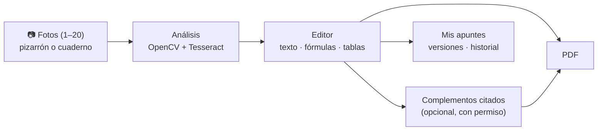

# ApuntIA: del pizarrón o el cuaderno a un apunte en PDF

ApuntIA convierte fotos de **pizarrones y cuadernos** en apuntes digitales: reconoce el texto y las
fórmulas, te deja corregirlo junto a la foto, puede añadir explicaciones de fuentes citadas si lo
permites y genera un **PDF** con portada, índice, tablas y fórmulas. Tus apuntes quedan guardados en
tu cuenta con todas sus versiones. Sin cuenta, también endereza y aclara una sola foto (PNG).



## Qué hace y qué no hace (estado comprobado)

| Función | Estado |
|---------|--------|
| Mejorar una foto (enderezar, ruido, contraste) → PNG, sin cuenta | ✅ Disponible |
| Cuentas: registro, sesión, recuperación de contraseña, perfil, borrar la cuenta | ✅ Disponible. La recuperación escribe el enlace en un buzón local: **no hay servidor de correo** |
| Apuntes de 1–20 fotos de pizarrón o cuaderno, en el orden elegido | ✅ Disponible |
| Reconocimiento de texto impreso (Tesseract 5, español e inglés) | ✅ CER 0,7 % en el banco de pruebas sintético ([evaluación](fullstack/docs/evaluacion.md)) |
| Letra manuscrita | ⚠️ Parcial: lo que no se lee con seguridad se marca y se conserva como imagen; no se inventa texto |
| Fórmulas a LaTeX | ⚠️ Parcial: las fórmulas en una línea (potencias, raíces, fracciones con `/`) sí; las de dos dimensiones (fracciones apiladas, matrices) se conservan como imagen y se pueden escribir en el editor |
| Tablas fotografiadas | ⚠️ Parcial: se lee el texto de las celdas, no la estructura; la tabla se arma en el editor con «Convertir en tabla» |
| Editor: corregir bloques, fórmulas con vista previa, tablas, esquemas, versiones, comparación | ✅ Disponible |
| Información complementaria de Wikipedia, con fuente y consentimiento | ✅ Disponible y **opcional** (necesita Internet) |
| PDF del apunte | ✅ Disponible, sin Internet |
| Mis apuntes: búsqueda, filtros, PDF, borrado | ✅ Disponible |
| Probado en | Linux con Chromium (pruebas automáticas). Windows, macOS, Firefox, Safari y móviles reales: **pendiente de probar** |

Resultados de cada escenario de uso (pizarrón, manuscrito, fórmulas, tabla, diagrama, varias páginas…),
criterios de rechazo y limitaciones: [fullstack/docs/aceptacion.md](fullstack/docs/aceptacion.md).

## Requisitos

| Modo | Necesitas | Espacio | Internet |
|------|-----------|---------|----------|
| **Scripts** (recomendado para desarrollar) | Python 3.10+ · Tesseract 5 con idioma español (sin él, solo «Mejorar una foto») | ~500 MB (entorno de Python) | Solo la primera vez, para instalar dependencias; luego, solo para la investigación opcional |
| **Docker** | Docker con Compose v2 | ~1 GB (imágenes) | Para construir las imágenes la primera vez |
| Pruebas automáticas | Node.js 22+ y `npx playwright install chromium` | ~300 MB | Para instalar |

Tesseract: Linux `sudo apt install tesseract-ocr tesseract-ocr-spa` · macOS `brew install tesseract tesseract-lang` ·
Windows: instalador de [UB-Mannheim](https://github.com/UB-Mannheim/tesseract/wiki) marcando el idioma *Spanish*.

## Inicio rápido

Todos los comandos se ejecutan **desde la carpeta raíz del repositorio** (la que contiene este README).

### Opción A: scripts (sin Docker)

Linux y macOS:

```bash
./iniciar.sh
```

Windows (PowerShell o CMD): doble clic en `iniciar.bat`, o:

```bat
iniciar.bat
```

El script comprueba Python, Tesseract y el puerto, crea el entorno virtual, instala dependencias
(solo si cambian), arranca la aplicación, espera a que responda y abre el navegador. Detalles,
opciones (`--puerto`, `--red` para el móvil…) y códigos de salida en [fullstack/docs/arranque.md](fullstack/docs/arranque.md).
> Los scripts de Windows aún **no se han ejecutado en un equipo con Windows**; los de Linux están
> probados automáticamente y los de macOS comparten el mismo script, sin prueba en un Mac.

Para pararla: `./detener.sh` (o `detener.bat`).

**Para una demostración** sin tocar tus datos: `./iniciar.sh --demo` crea una cuenta
`demo@example.com` con apuntes de ejemplo sintéticos en una carpeta aparte; guía de ~10 minutos en
[fullstack/docs/entrega.md](fullstack/docs/entrega.md#5-guía-de-demostración--10-minutos).

### Opción B: Docker

```bash
docker compose -f fullstack/compose.yaml up --build -d
```

Para pararla (los datos se conservan): `docker compose -f fullstack/compose.yaml down`. Más en [fullstack/docs/docker.md](fullstack/docs/docker.md).

### Después de arrancar

| Dirección | Qué es |
|-----------|--------|
| http://localhost:8000/inicio | Mejorar una foto (sin cuenta) y entrada a todo |
| http://localhost:8000/front/cuenta.html | Crear cuenta o entrar |
| http://localhost:8000/front/nuevo.html | Crear un apunte con tus fotos |
| http://localhost:8000/front/apuntes.html | Mis apuntes |
| http://localhost:8000/front/ayuda.html | Ayuda y estado real de cada función |
| http://localhost:8000/docs | Documentación interactiva de la API |
| http://localhost:8000/salud · `/api/v2/listo` | ¿Responde? · ¿están listas sus dependencias? |

`index.html` también se puede abrir con doble clic para mejorar una foto (necesita el servidor en marcha).

## Cómo se usa

1. **Crear cuenta** (Entrar → Crear cuenta).
2. **Crear apuntes:** añade las fotos (archivo, cámara o arrastrándolas), ordénalas e indica si son de pizarrón o de cuaderno (lo sugiere ApuntIA). Pulsa «Crear apunte».
3. **Revisar:** el editor muestra el avance del análisis y después cada bloque junto a su región en la foto. Corrige el texto, las fórmulas (con vista previa) y las tablas; lo dudoso está marcado.
4. **Ampliar (opcional):** en «Complementos», permite la búsqueda, elige palabras clave y acepta solo lo que quieras; cada complemento lleva su fuente.
5. **PDF:** en la pestaña «PDF», elige las opciones, genéralo, revísalo y descárgalo.
6. **Historial:** cada guardado es una versión que puedes comparar o restaurar; todo queda en «Mis apuntes».

Recorrido técnico completo: [fullstack/docs/flujo-v2.md](fullstack/docs/flujo-v2.md).

## Configuración

La primera ejecución crea `fullstack/config/.env` a partir de [`fullstack/config/.env.example`](fullstack/config/.env.example),
con valores seguros por defecto (puerto 8000, datos en `back/motori_magenes/datos/`, investigación
permitida a nivel de servidor pero desactivada para cada persona hasta que la active). No contiene
contraseñas ni claves; no la subas al repositorio. Variables principales:

| Variable | Defecto | Para qué |
|----------|---------|----------|
| `APUNTIA_PUERTO` | 8000 | Puerto de la aplicación |
| `DATA_DIR` | `datos` | Base de datos y archivos privados |
| `MAX_UPLOAD_MB`, `MAX_PAGINAS` | 10, 20 | Límites de subida |
| `OCR_MOTOR`, `OCR_IDIOMAS` | `tesseract`, `spa+eng` | Reconocimiento de texto |
| `RECONOCIMIENTO_MODO` | `adaptativo` | `clasico` vuelve al flujo anterior a BACK-28 ([PROCESAMIENTO.md](back/motori_magenes/PROCESAMIENTO.md#reconocimiento-adaptativo-back-28)) |
| `INVESTIGACION_PROVEEDOR` | `wikipedia` | `ninguno` para trabajar sin Internet |
| `COOKIE_SEGURA`, `URL_PUBLICA` | 0, vacío | Solo si se publica por HTTPS |

Copias de seguridad: `fullstack/scripts/respaldar.sh` y `restaurar.sh` ([fullstack/docs/respaldo.md](fullstack/docs/respaldo.md)).

## Problemas frecuentes

| Síntoma | Solución |
|---------|----------|
| «Hace falta Python 3.10 o superior» | Instálalo; en Windows marca «Add python.exe to PATH» |
| «El puerto 8000 está ocupado» | `./iniciar.sh --puerto 8080` (o `iniciar.bat -Puerto 8080`) |
| «Tesseract no está instalado» / los apuntes no se analizan | Instálalo (ver Requisitos) y vuelve a arrancar; la ayuda muestra si está disponible |
| «No se pudo crear el entorno virtual» | Debian/Ubuntu: `sudo apt install python3-venv` |
| «ApuntIA no arrancó» | Mira `fullstack/.estado/backend.log` o ejecuta `fullstack/scripts/diagnostico.sh` |
| Docker: «Cannot connect to the Docker daemon» | Abre Docker Desktop o arranca el servicio de Docker |
| La página de cuenta dice «Abre ApuntIA desde el servidor» | Usa `http://localhost:8000/…`, no el archivo con doble clic |
| «Tu espacio está lleno» / «el servidor no tiene espacio» | Borra apuntes antiguos o libera disco; `/api/v2/listo` avisa |
| Un error con «Referencia: …» | Búscala en el registro: [fullstack/docs/diagnostico.md](fullstack/docs/diagnostico.md) |

## Pruebas

```bash
fullstack/scripts/validar.sh
```

Modo rápido (~1 min): pruebas del backend, evaluación real del OCR contra la línea base, búsqueda
de secretos y reglas de seguridad de la interfaz. `--completo` (~6 min) añade la interfaz y la
integración de punta a punta con el backend real; `--docker`, la prueba de los contenedores. La CI
de GitHub ejecuta lo mismo en cada pull request. Detalle: [fullstack/docs/ci.md](fullstack/docs/ci.md).

## Documentación

| Tema | Documento |
|------|-----------|
| **Índices** | [toda la documentación transversal](fullstack/docs/README.md) · [documentación de la interfaz](front/docs/README.md) · [dónde va cada documento](fullstack/docs/ESTRUCTURA_DOCUMENTAL.md) |
| Tickets e Issues | [fichas de todos los Issues, cronograma planificado y bitácoras reales](fullstack/tickets/README.md) · [índice](fullstack/tickets/INDICE.md) |
| Arquitectura y decisiones | [arquitectura](fullstack/docs/arquitectura.md) · [flujo v2](fullstack/docs/flujo-v2.md) · [datos](fullstack/docs/datos.md) |
| API | [v1 (`/analisis`)](fullstack/docs/api.md) · [v2 (cuentas, apuntes, PDF)](fullstack/docs/api-v2.md) · [servidor IA (BACK-35)](fullstack/docs/servidor-ia.md) |
| Interfaz | [páginas v2](front/docs/interfaz-v2.md) · [pruebas de interfaz](front/docs/pruebas-interfaz.md) · [frontend](front/README.md) |
| Backend | [instalación y uso](back/motori_magenes/README.md) · [procesamiento y OCR](back/motori_magenes/PROCESAMIENTO.md) |
| Arranque | [scripts](fullstack/docs/arranque.md) · [Docker](fullstack/docs/docker.md) · [carpeta fullstack](fullstack/README.md) |
| Seguridad y privacidad | [auditoría](fullstack/docs/seguridad.md) · [API](fullstack/docs/seguridad-api.md) · [permisos](fullstack/docs/permisos.md) · [privacidad](fullstack/docs/privacidad.md) |
| Operación | [diagnóstico](fullstack/docs/diagnostico.md) · [copias de seguridad](fullstack/docs/respaldo.md) |
| Calidad | [evaluación del OCR y PDF](fullstack/docs/evaluacion.md) · [pruebas del backend](fullstack/docs/pruebas-backend.md) · [pruebas de interfaz](front/docs/pruebas-interfaz.md) · [CI](fullstack/docs/ci.md) |
| Entrega | [instalación desde cero, demostración, versión y actualización](fullstack/docs/entrega.md) · [aceptación y evidencias](fullstack/docs/aceptacion.md) · [cambios por versión](CHANGELOG.md) |
| Proyecto | [alcance](fullstack/docs/alcance.md) · [definición de hecho](fullstack/docs/definicion-de-hecho.md) · [dependencias y licencias](fullstack/docs/dependencias.md) · [cómo contribuir](CONTRIBUTING.md) |

## Datos de ejemplo y licencias

Las pruebas y la evaluación usan **datos sintéticos** generados por código (fotos con texto dibujado
con las fuentes DejaVu, cuentas `@example.com`); la única foto real (`back/bd/img/image.png`) es del
propio proyecto. No subas fotos de apuntes ajenos al repositorio. Las dependencias y sus licencias
(todas libres: MIT, BSD, Apache-2.0…) están en [fullstack/docs/dependencias.md](fullstack/docs/dependencias.md); Tesseract
y sus datos de idioma son Apache-2.0; el contenido de Wikipedia es CC BY-SA 4.0 y se cita en el PDF.

Proyecto académico ApuntIA.
