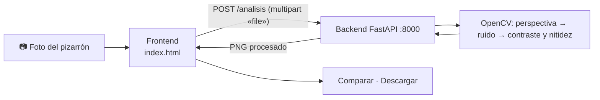

# ApuntIA: apuntes del pizarrón, legibles

ApuntIA convierte la foto de un pizarrón en una imagen **enderezada, sin ruido y más nítida**.
Se toma la foto (o se elige de la galería), se procesa con visión por computadora y se compara con la original antes de descargarla.

| Parte | Tecnología | Carpeta |
|-------|------------|---------|
| Frontend | HTML, CSS y JavaScript sin dependencias | `index.html`, `front/` |
| Backend | Python, FastAPI y OpenCV | `back/motori_magenes/` |



## Inicio rápido

Requisitos: **Python 3.10 o superior** y, solo para las pruebas automáticas, **Node.js 18 o superior**.

**1. Backend** (la guía completa para Windows, macOS y Linux está en [`back/motori_magenes/README.md`](back/motori_magenes/README.md)):

```bash
cd back/motori_magenes
```

```bash
python -m venv .venv
```

Activa el entorno (Windows: `.\.venv\Scripts\Activate.ps1` · macOS/Linux: `source .venv/bin/activate`) y después:

```bash
pip install -r requirements.txt
```

```bash
uvicorn main:app --reload
```

**2. Frontend:** en otra terminal, desde la raíz del repositorio:

```bash
python -m http.server 5500
```

Abre http://localhost:5500/index.html, elige una foto y pulsa **«Procesar imagen»**. También funciona abriendo `index.html` con doble clic.
Para usarlo desde el celular en la misma red, ver [`docs/ejecutar.md`](docs/ejecutar.md).

| Dirección | Qué es |
|-----------|--------|
| http://localhost:5500/index.html | La aplicación |
| http://localhost:8000/docs | Documentación interactiva de la API |
| http://localhost:8000/salud | Estado del backend |
| `index.html?mock=ok` | La aplicación con respuestas simuladas, sin backend |

## Pruebas

| Batería | Comando | Resultado |
|---------|---------|-----------|
| Backend (pytest) | `python -m pytest` desde `back/motori_magenes`, tras instalar `requirements-dev.txt` | 74 correctas |
| Interfaz (Playwright, API simulada) | `npm run test:front` | 20 correctas |
| Integración (interfaz + FastAPI reales) | `npm run test:integracion` | 19 correctas |

Antes de las pruebas de Node, instala sus dependencias:

```bash
npm install
```

```bash
npx playwright install chromium
```

## Documentación

- [**Arquitectura**](docs/arquitectura.md): componentes, flujo, carpetas, puertos, variables, CORS, comandos, dependencias, decisiones y cómo reproducir una prueba integral.
- [Flujo y alcance](docs/flujo.md) · [Contrato de la API](docs/api.md) · [Ejecutar el proyecto completo](docs/ejecutar.md)
- [Plan de integración](docs/integracion.md) · [Compatibilidad](docs/compatibilidad.md) · [Incidencias](docs/incidencias.md)
- [Pruebas de interfaz](docs/pruebas-frontend.md) · [Pruebas de integración](docs/pruebas-integracion.md) · [Validación de UX](docs/validacion-ux.md)
- [Backend: instalación y uso](back/motori_magenes/README.md) · [Detalles del procesamiento](back/motori_magenes/PROCESAMIENTO.md) · [Frontend](front/README.md)

## Estado

Versión 1.0: todos los issues BACK, FRONT y FULL implementados, con pruebas y evidencias. Quedan pendientes, con responsables humanos: la aprobación formal del flujo y el contrato, las pruebas en Firefox, Safari y celulares reales, y la bitácora de cada issue (ver [`docs/integracion.md`](docs/integracion.md#4-bloqueos-y-riesgos)).

Proyecto académico ApuntIA.
