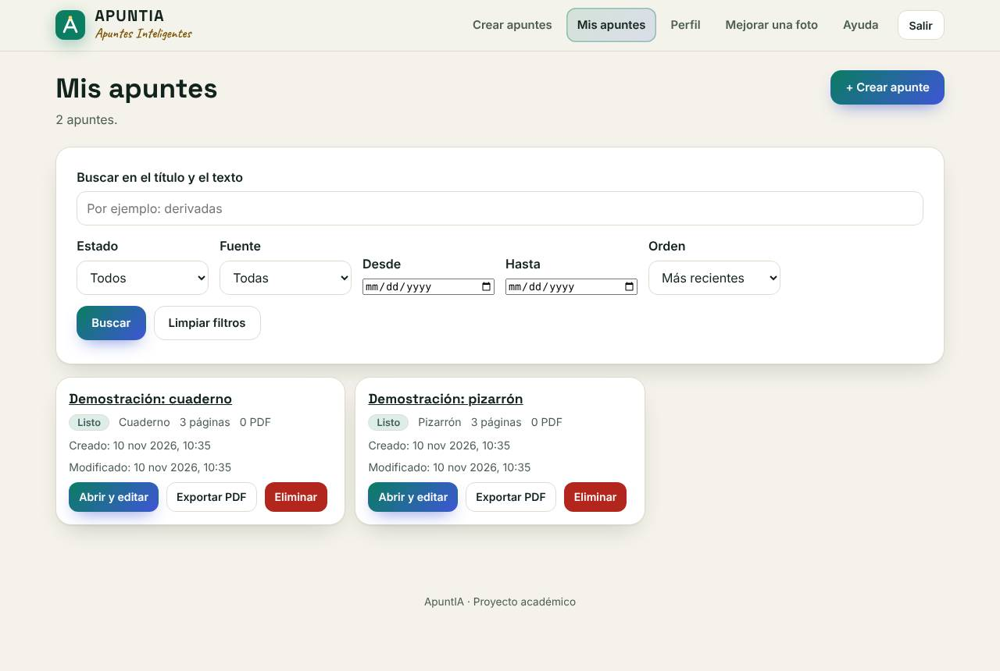
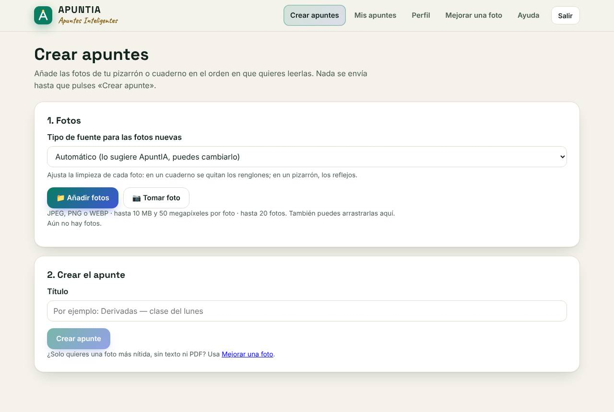
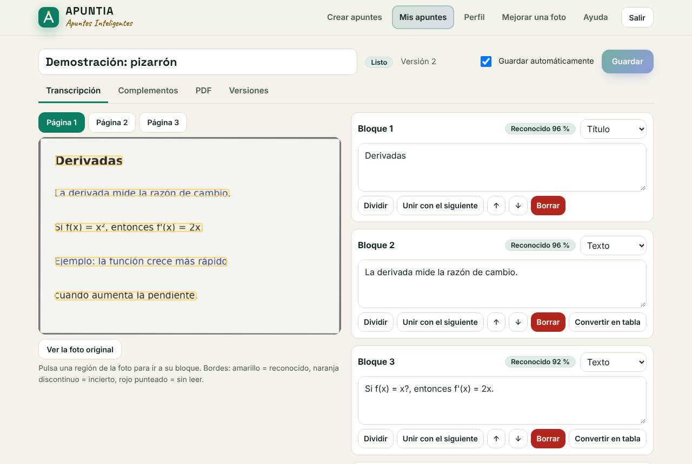
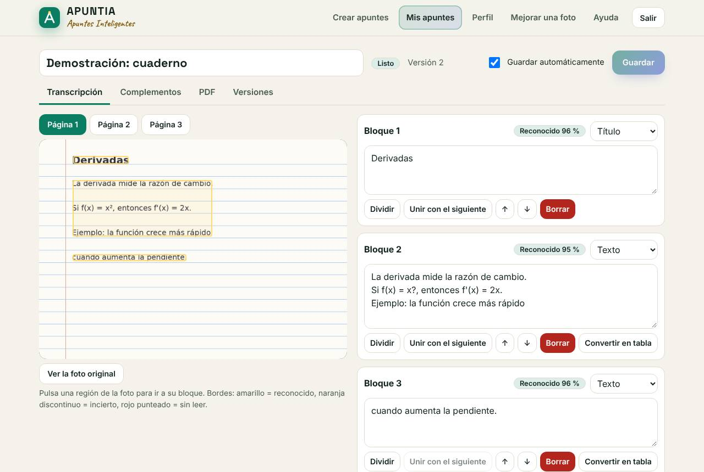
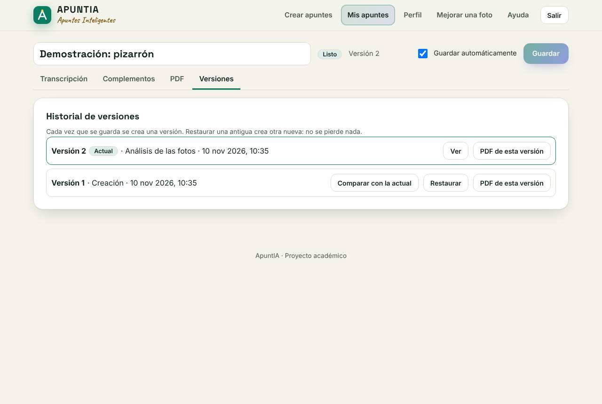
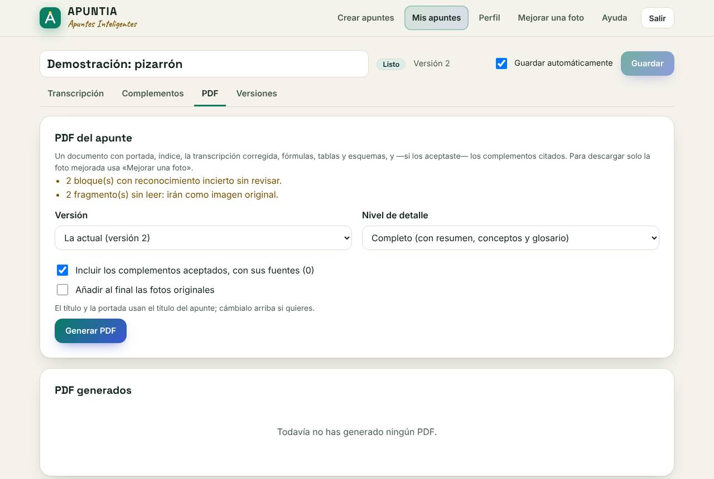
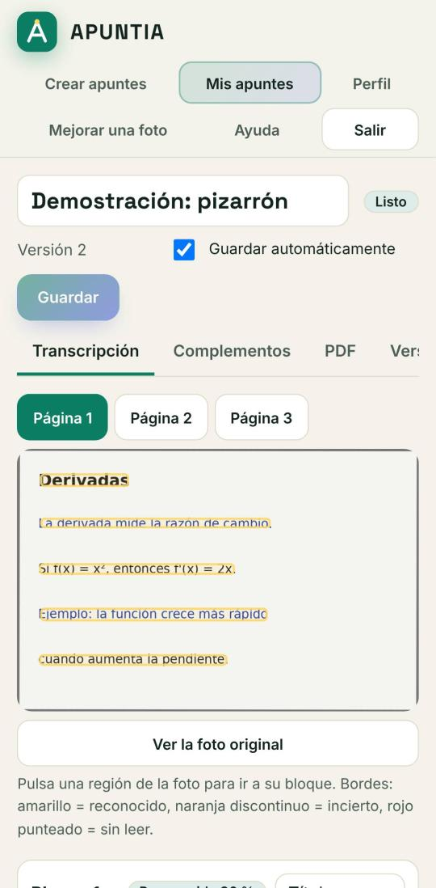

# Aceptación educativa y evidencia de entrega (FULL-24)

Cierra el ciclo de calidad de la versión 2.0.0 con **resultados reales**: el análisis de producción
sobre fotos (sintéticas) de los casos de uso del aula, el PDF leído de vuelta y criterios de rechazo
que paran la entrega. Aquí se dice qué está completo, qué es parcial y qué sigue pendiente, sin
presentar como hecho nada que no se haya ejecutado.

```bash
python fullstack/evaluacion/aceptacion.py
```

Sube cada escenario como un apunte por la API (en proceso, con datos temporales), espera al análisis,
genera el PDF y lo lee con pypdf. Escribe `aceptacion.md` y `aceptacion.json` en
`fullstack/evaluacion/resultados/<fecha>/` y **sale con 1** si se cumple un criterio de rechazo o falla
un escenario. Se ejecuta en `fullstack/scripts/validar.sh` y, por tanto, en la CI. Tarda ~13 s.

## 1. Escenarios y resultados (2026-11-10)

Fotos **sintéticas** generadas por código ([corpus](../back/motori_magenes/herramientas/corpus.py)):
ningún apunte ni foto de una persona real. «Reconocidos sin estar en la foto» cuenta los bloques
marcados como seguros cuyo texto no coincide con la referencia (el único caso es «x²» leído como «x?»,
ver D6 en [incidencias](incidencias.md#versión-2-defectos-encontrados-al-preparar-la-entrega)).

| Id | Escenario | Estado | Resultado medido |
|----|-----------|--------|------------------|
| E1 | Pizarrón corto (foto inclinada) | ✅ completo | Análisis en 0,7 s · CER 0,7 % · PDF de 3 páginas con el texto |
| E2a | Cuaderno manuscrito (claro) | ⚠️ parcial | CER 0,0 % y nada inventado, pero con **letra sintética**: con letra real de alumnos no se ha medido |
| E2b | Cuaderno manuscrito (difícil) | ⚠️ parcial | CER 5,6 % · 1 bloque marcado como incierto · ningún error presentado como seguro |
| E3 | Imagen difícil: ruido, sombra, pizarrón verde de tiza | ✅ completo | CER 0,7 % en los tres casos · PDF correcto |
| E4 | Hoja impresa en cuaderno rayado y cuadriculado | ✅ completo | CER 0,7 % · los renglones y la cuadrícula no se leen como texto |
| E5a | Fórmulas en una línea | ⚠️ parcial | 4 fórmulas: 3 con LaTeX exacto, 1 conservada como imagen, **0 falsas, 0 perdidas** · PDF con las 4 |
| E5b | Fórmulas en dos dimensiones | ⚠️ parcial | 0 en LaTeX: las 4 se conservan como imagen (0 falsas, 0 perdidas) y se escriben en el editor |
| E6 | Tabla fotografiada | ⚠️ parcial | 7/8 celdas y el título leídos como texto; la **estructura de tabla** la crea el usuario («Convertir en tabla») y sale completa en el PDF |
| E7 | Diagrama | ✅ completo | El dibujo se conserva como imagen (2 recortes en el PDF), el título se lee, no se inventa texto |
| E8 | Varias páginas (3: texto, diagrama, fórmulas) | ✅ completo | Bloques y PDF en el orden de las fotos · 1,8 s |
| E9 | Recorrido **sin** información complementaria | ✅ completo | PDF sin sección de complementos ni enlaces externos |
| E10 | Recorrido **con** información complementaria | ✅ completo | Exige el permiso del perfil (400 sin él); un concepto sin página no produce nada; lo propuesto no entra al PDF hasta aceptarlo; lo aceptado entra con cita, licencia y enlace. **Fuente simulada** con el formato real de la API (la prueba no depende de Internet) |
| E11 | Sin conexión o sin proveedor | ✅ completo | Fuente caída → trabajo fallido `INVESTIGACION_NO_DISPONIBLE`; sin proveedor → 503; el apunte no cambia |
| R1 | Hoja en blanco | ✅ completo | Análisis sin bloques; la exportación falla con `APUNTE_VACIO` (no se entrega un PDF vacío) |
| R4 | Otra cuenta intenta usar el apunte | ✅ completo | Ver, versiones, editar, exportar y borrar → 404; no aparece en su lista; el dueño lo sigue viendo |

**Lectura:** el texto impreso (pizarrón y cuaderno, también con mala luz) es fiable; manuscrito,
fórmulas y tablas son **parciales** por diseño honesto: lo que no se lee con seguridad se marca o se
conserva como imagen, nunca se inventa ni se pierde, y el editor permite completarlo.

## 2. Criterios de rechazo

Si cualquiera se cumple, la versión **no se entrega**. Resultado actual: ninguno se cumple.

| Criterio | Dónde se comprueba | Estado |
|----------|--------------------|--------|
| PDF vacío o sin el contenido del apunte | `aceptacion.py` (E1–E8, R1), `test_pdf.py::test_apunte_vacio_falla_sin_pdf_enganoso` | ✅ no ocurre |
| Pérdida de fórmula (ni LaTeX, ni texto, ni imagen) o fórmula falsa marcada como segura | `aceptacion.py` (E5), `test_formulas.py`, banco FULL-19 | ✅ no ocurre |
| Cita inventada o complemento sin fuente | `aceptacion.py` (E10, E11), `test_investigacion.py`, `v2-investigacion.test.js` | ✅ no ocurre |
| Texto inventado a partir de un dibujo o un manuscrito | `aceptacion.py` (E2, E7), banco FULL-19 («reconocidos con errores» en manuscrito: 0) | ✅ no ocurre |
| Acceso a apuntes, fotos o PDF de otra cuenta | `aceptacion.py` (R4), `test_seguridad_api.py` (cada ruta con id), `v2-permisos.test.js` | ✅ no ocurre |
| Arranque imposible desde un clon limpio | `npm run test:entrega` (scripts y Docker), [evidencia de clon limpio](evidencias/full-22-clon-limpio.md) | ✅ arranca |
| Datos perdidos al reiniciar o actualizar | `test:entrega` (reinicio), `test_respaldo.py`, `docker.test.js` (volumen) | ✅ no ocurre |

### Regresión completa automatizada (2026-11-10)

`fullstack/scripts/validar.sh --completo` en 6 min 30 s, todo en verde: backend 375 pruebas,
evaluación real 12, banco de evaluación 9/9 sin regresiones, aceptación 18 escenarios sin rechazos,
interfaz con API simulada 20, integración con el backend real (v1, v2, accesibilidad) 112, scripts 6,
entrega con scripts y demostración 2. Por separado, `npm run test:entrega` con Docker: 3/3
([entrega.md](entrega.md#4-prueba-de-humo-de-la-entrega)).

## 3. Inspección manual (2026-11-10)

Además de lo automático, se miraron a ojo un PDF y la interfaz real con la cuenta de demostración:

- **PDF** (pizarrón + fórmulas + un complemento aceptado): portada con avisos de lo incierto, índice,
  transcripción con lo dudoso marcado («reconocimiento incierto: revisar»), fórmulas dibujadas desde su
  LaTeX (la fracción, apilada), la no reconocida como imagen, el complemento separado («No forma parte
  de tu apunte») y la fuente con autor, URL, fecha de consulta y licencia. **Encontrado y corregido:**
  la fórmula no reconocida salía rotulada como «fragmento manuscrito» (D5).
- **Interfaz**: capturas reales de la v2 en la sección 7. En el móvil la barra de pestañas del editor
  se desplaza y la última («Versiones») se ve cortada: es usable, pero conviene un indicio visual (D7).

## 4. Matriz requisito → issue → endpoint → prueba → evidencia

Issues del repositorio original del proyecto (victorgaelpch/ApuntIA): FULL-11…24 = #41–#54,
BACK-11…15 = #55–#59, BACK-17…27 = #60–#70, FRONT-11…22 = #71–#82.

| Requisito | Issues | Endpoints | Pruebas | Evidencia | Estado |
|-----------|--------|-----------|---------|-----------|--------|
| Mejorar una foto sin cuenta (v1 intacta) | v1, FULL-15 | `POST /analisis`, `GET /salud` | `test_api.py`, `test_regresion.py` (contrato congelado), `flujo.test.js` | [api.md](api.md) | ✅ completo |
| Cuentas: registro, sesión, recuperación, perfil, borrado | BACK-23, FRONT-17, FRONT-19, FULL-18 | `/api/v2/auth/*`, `/api/v2/perfil` | `test_cuentas.py`, `v2-cuenta`, `v2-perfil`, `v2-permisos` | [permisos.md](permisos.md) | ⚠️ parcial: la recuperación usa un buzón local, **sin servidor de correo** |
| Apunte de 1–20 fotos de pizarrón o cuaderno | BACK-11, FRONT-12 | `POST /api/v2/apuntes` | `test_entrada.py`, `v2-nuevo` | E8, `full-24-nuevo.jpg` | ✅ completo |
| Análisis como trabajo (avance, cancelar, reintentar) | BACK-21, BACK-27 | `/api/v2/trabajos/*` | `test_trabajos.py`, `test_analisis.py` | [flujo-v2.md](flujo-v2.md) | ✅ completo |
| OCR de texto impreso | BACK-12, BACK-13 | (dentro del análisis) | `test_ocr.py`, `test_preprocesado_ocr.py`, banco FULL-19 | E1, E3, E4; [evaluacion.md](evaluacion.md) | ✅ completo (CER 0,7 %) |
| Manuscrito sin inventar texto | BACK-14 | (análisis) | `test_manuscrito.py`, banco | E2 | ⚠️ parcial (letra real sin medir) |
| Fórmulas a LaTeX verificable | BACK-15, FRONT-14 | `POST /api/v2/formulas/validar` | `test_formulas.py`, `v2-contenido` | E5 | ⚠️ parcial (2D como imagen) |
| Tablas | BACK-17, FRONT-14 | `PUT /api/v2/apuntes/{id}/documento` | `test_documento.py`, `test_pdf.py`, `v2-contenido` | E6 | ⚠️ parcial (la estructura la crea el usuario) |
| Diagramas y esquemas | BACK-19, FRONT-14 | (análisis, editor) | `test_estructura.py`, banco | E7 | ✅ completo (como imagen; sin descripción automática) |
| Editor con la foto al lado, versiones, comparación | BACK-17, BACK-26, FRONT-13, FRONT-22 | `GET/PUT /apuntes/{id}`, `/versiones/*` | `test_historial.py`, `v2-editor`, `v2-versiones` | `full-24-editor-*.jpg` | ✅ completo |
| Información complementaria con consentimiento y cita | BACK-18, FRONT-15 | `/conceptos`, `/investigacion`, `/ampliaciones/{id}` | `test_investigacion.py`, `v2-investigacion` | E10, E11 | ⚠️ parcial: probado con fuente simulada; **Wikipedia real sin comprobar** desde este entorno (sin acceso) |
| PDF académico | BACK-20, FRONT-16 | `/exportaciones*` | `test_pdf.py`, `v2-pdf`, banco | E1–E10, sección 3 | ✅ completo |
| Mis apuntes: búsqueda, filtros, historial | BACK-26, FRONT-18 | `GET /api/v2/apuntes` | `test_historial.py`, `v2-apuntes` | `full-24-mis-apuntes.jpg` | ✅ completo |
| Autorización por propietario y API endurecida | BACK-22, BACK-24, FULL-20 | todas | `test_seguridad_api.py`, `v2-permisos` | R4; [seguridad.md](seguridad.md) | ✅ completo (riesgos abiertos listados allí) |
| Mensajes de error comprensibles | FRONT-20 | catálogo `{error:{codigo,mensaje}}` | `catalogo.test.js`, `v2-errores` | [interfaz-v2.md](interfaz-v2.md) | ✅ completo |
| Accesibilidad básica y diseño adaptable | FRONT-21 | — | `v2-accesibilidad` (etiquetas, ARIA, contraste WCAG AA, teclado, anchos de 320–1280 px), `v2-navegacion` | `full-24-movil.jpg`; [pruebas-interfaz.md](pruebas-interfaz.md) | ⚠️ parcial: Chromium emulado; **móviles reales, Firefox y Safari pendientes** |
| Arranque con scripts y Docker | FULL-11, FULL-12, FULL-13 | `/salud`, `/api/v2/listo` | `test:scripts`, `test:docker`, `test:entrega` | [entrega.md](entrega.md) | ⚠️ parcial: Linux probado; **Windows y macOS sin probar** |
| Diagnóstico y copias de seguridad | FULL-21, FULL-23 | `/api/v2/listo`, `/api/v2/diagnostico` | `test_diagnostico.py`, `test_respaldo.py` | [diagnostico.md](diagnostico.md), [respaldo.md](respaldo.md) | ✅ completo |
| Banco de evaluación y CI | FULL-17, FULL-19, BACK-25 | — | `validar.sh`, CI | [evaluacion.md](evaluacion.md), [ci.md](ci.md) | ✅ completo |
| Entrega reproducible y demostración | FULL-22 | — | `test:entrega` | [entrega.md](entrega.md) | ✅ completo en Linux |
| Validación con usuarios externos | FULL-24 | — | — | sección 5 | ⏳ **pendiente** (la deben hacer personas) |

## 5. Sesiones con usuarios externos (pendiente)

El issue pide sesiones de aceptación con personas que no hayan desarrollado ApuntIA. **No se han
hecho** y no pueden hacerse de forma automática: quedan a cargo del equipo antes de la entrega.

**Protocolo propuesto (20 min por persona, al menos 3 personas, una con móvil):**

1. Arrancar con `./iniciar.sh --demo-nueva` (datos sintéticos, aparte).
2. Sin ayuda, pedir: crear una cuenta; crear un apunte con 2–3 fotos de un pizarrón **del propio aula
   con permiso** (sin nombres ni datos de personas); corregir un bloque dudoso y una fórmula; generar y
   abrir el PDF; recuperar una versión anterior desde el historial.
3. Anotar por tarea: ¿la terminó? (sí / con ayuda / no), tiempo, errores que no entendió, y su opinión
   sobre la corrección del texto y la utilidad del PDF (1–5).
4. Registrar cada problema como defecto (formato de la sección 6) y no subir las fotos al repositorio.

| Persona (rol, sin nombre) | Dispositivo | Tareas completadas | Problemas | Valoración |
|---------------------------|-------------|--------------------|-----------|------------|
| _pendiente_ | | | | |

## 6. Defectos

Registro con pasos de reproducción, prioridad y estado en
[incidencias.md](incidencias.md#versión-2-defectos-encontrados-al-preparar-la-entrega) (D2–D7). Los
issues afectados del repositorio original no se pudieron reabrir desde este entorno (sin permisos de
escritura en él): los commits de corrección los citan con `Refs:` para que el equipo decida.

## 7. Manual de uso y capturas

El manual de uso es la sección «Cómo se usa» del [README](../README.md#cómo-se-usa), la página de
ayuda de la aplicación (`/front/ayuda.html`, con el estado real de cada función) y la
[guía de demostración](entrega.md#5-guía-de-demostración--10-minutos). Capturas reales de la v2 con la
cuenta de demostración (2026-11-10, Chromium):

| Pantalla | Captura |
|----------|---------|
| Mis apuntes |  |
| Crear apuntes |  |
| Editor: foto de pizarrón y bloques |  |
| Editor: cuaderno rayado |  |
| Versiones |  |
| PDF |  |
| Móvil (Pixel 7 emulado) |  |

## 8. Limitaciones actuales

- **Manuscrito real:** medido solo con letra sintética; lo ilegible se marca o se conserva como imagen.
- **Fórmulas en dos dimensiones** (fracciones apiladas, matrices): se conservan como imagen; LaTeX a mano.
- **Tablas fotografiadas:** se lee su texto, no su estructura; «Convertir en tabla» en el editor.
- **Diagramas:** se conservan como imagen; no hay descripción automática.
- **Errores de OCR sin aviso:** un símbolo como «²» puede leerse mal y marcarse como seguro (D6).
- **Información complementaria:** solo Wikipedia (es/en), con Internet; probada con fuente simulada.
- **Sin servidor de correo:** la recuperación de contraseña escribe el enlace en un buzón local.
- **Plataformas:** Linux probado; Windows, macOS, Firefox, Safari y móviles reales, sin probar.
- **Sin validación con usuarios externos** (sección 5).
