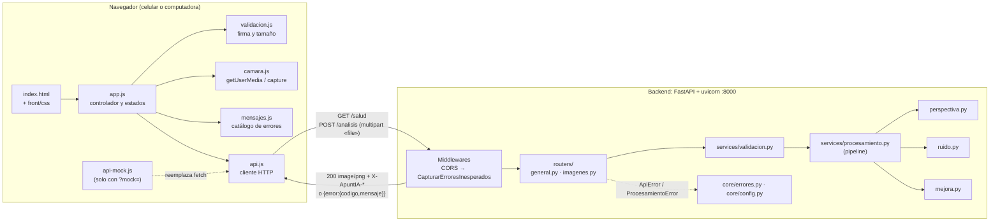
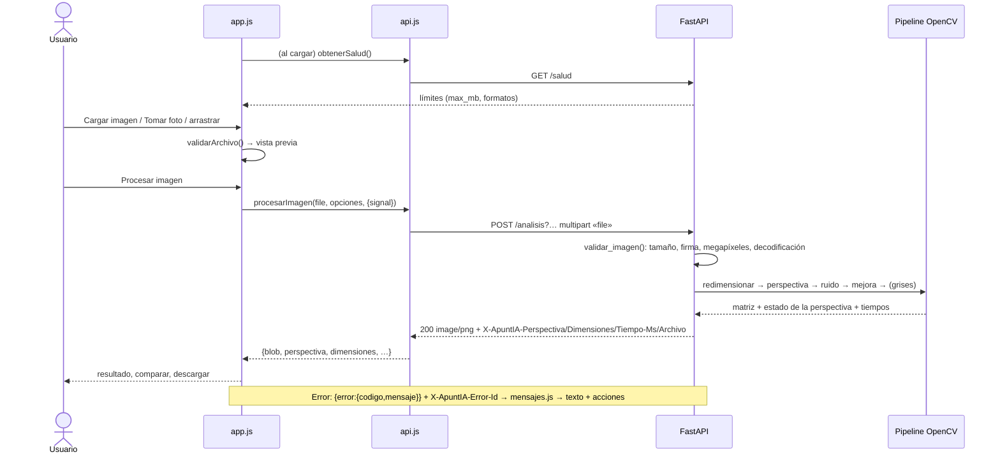

# Arquitectura de ApuntIA (FULL-10)

## 1. Componentes



| Capa | Responsabilidad | No hace |
|------|-----------------|---------|
| `app.js` | Estado de la pantalla, eventos, vista previa, resultado y errores | Conocer URLs o el formato HTTP |
| `api.js` | Construir la petición según el contrato, interpretar respuestas, tiempo máximo y cancelación | Mostrar nada en pantalla |
| `routers/` | Traducir HTTP ↔ funciones | Validar ni procesar |
| `services/` | Validar y procesar con NumPy/OpenCV, sin depender de FastAPI | Conocer HTTP |
| `core/` | Configuración (entorno, `.env`) y respuestas de error comunes | — |

## 2. Flujo principal



Flujo detallado, con los casos de error y el alcance: [`flujo.md`](flujo.md).

## 3. Carpetas

```
ApuntIA/
├── index.html                  # Pantalla principal (frontend)
├── front/
│   ├── css/index.css           # Sistema visual (compartido con la maqueta)
│   ├── css/principal.css       # Estilos de la pantalla principal
│   ├── js/                     # config · api · api-mock · mensajes · validacion · camara · app
│   ├── tests/                  # Pruebas de interfaz (Playwright, API simulada)
│   ├── maqueta.html, js/index.js   # Prototipo de UX (referencia, IA simulada)
│   └── README.md
├── back/
│   ├── bd/img/image.png        # Foto real de ejemplo
│   └── motori_magenes/         # Backend FastAPI (ver su README)
│       ├── main.py · app/ · herramientas/ · tests/
│       ├── requirements*.txt · .env.example
│       └── README.md · PROCESAMIENTO.md
├── tests/integracion/          # Pruebas frontend + backend reales
├── docs/                       # Esta documentación y evidencias
├── package.json                # Scripts de prueba de Node (Playwright)
└── requirements.txt            # → back/motori_magenes/requirements.txt
```

## 4. Configuración

| Qué | Dónde | Valor por defecto |
|-----|-------|-------------------|
| Puerto del backend | Parámetro `--port` de uvicorn | `8000` |
| Puerto del frontend | El del servidor estático (o `file://`) | `5500` en los ejemplos |
| URL de la API (frontend) | `?api=` → `front/js/config.js` `apiUrl` → mismo host, puerto 8000 | `http://<host-de-la-página>:8000` |
| Tiempo máximo de petición | `front/js/config.js` `timeoutMs` | 60 s |
| Tamaño máximo | `MAX_UPLOAD_MB` (backend; el frontend lo lee de `/salud`) | 10 MB |
| Resolución máxima de entrada | `MAX_MEGAPIXELES` | 50 MP |
| Lado de procesamiento | `MAX_LADO_PROCESAMIENTO` | 2000 px |
| CORS | `CORS_ORIGINS` (orígenes separados por comas) | `*` |
| Nombre en `/docs` | `APP_NAME` | `ApuntIA - Motor de imágenes` |

Las variables del backend se leen del entorno o de `back/motori_magenes/.env` (plantilla: `.env.example`, nunca se sube al repositorio). **CORS:** se permiten `GET` y `POST` sin credenciales, y se exponen `Content-Disposition` y `X-ApuntIA-*`. Detalles en [`ejecutar.md`](ejecutar.md#4-cors).

## 5. Comandos de arranque

| Qué | Comando (desde) |
|-----|-----------------|
| Instalar el backend | `pip install -r requirements.txt` (`back/motori_magenes`, con el `.venv` activo) |
| Levantar el backend | `uvicorn main:app --reload` (`back/motori_magenes`) |
| Servir el frontend | `python -m http.server 5500` (raíz), o doble clic en `index.html` |
| Pruebas del backend | `python -m pytest` (`back/motori_magenes`, con `requirements-dev.txt`) |
| Instalar las pruebas de Node | `npm install` y `npx playwright install chromium` (raíz) |
| Pruebas de la interfaz | `npm run test:front` (raíz) |
| Pruebas de integración | `npm run test:integracion` (raíz; `PYTHON=` si el backend está en un `.venv`) |

## 6. Dependencias

| Capa | Dependencias | Versión probada |
|------|--------------|-----------------|
| Backend | Python ≥ 3.10, `fastapi`, `uvicorn[standard]`, `python-multipart`, `opencv-python-headless`, `numpy`, `pillow` | Python 3.13 · FastAPI 0.162 · OpenCV 5.0 · NumPy 2.5 · Pillow 13 |
| Pruebas del backend | `pytest`, `httpx` | pytest 9.2 |
| Frontend | Ninguna (HTML, CSS y JS sin compilar); fuentes de Google Fonts | Navegadores actuales |
| Pruebas de Node | Node ≥ 22 (los patrones `*.test.js` de `node --test` requieren Node 21+), `playwright` | Node 22 · Playwright 1.63 · Chromium |

## 7. Documentación de la API

- Contrato escrito: [`api.md`](api.md).
- Documentación interactiva con el backend levantado: http://localhost:8000/docs (Swagger) y http://localhost:8000/redoc.
- Compatibilidad verificada entre capas: [`compatibilidad.md`](compatibilidad.md).

## 8. Decisiones técnicas

El registro completo, con fecha y motivo, está en [`integracion.md`](integracion.md#5-registro-de-decisiones). Las principales:

| Decisión | Por qué |
|----------|---------|
| Resultado como PNG en la misma respuesta; nada se guarda en el servidor | Sin almacenamiento ni temporales que limpiar; sin URLs que caduquen |
| Validación por firma binaria en las dos capas | La extensión y el `accept` se pueden falsear; el backend es la fuente de verdad |
| Estructura de error única y mensajes decididos por el frontend según el `codigo` | Textos coherentes, sin trazas, y acciones para resolver |
| Pipeline independiente de FastAPI, con etapas desactivables | Reutilizable y medible (benchmark por etapa) |
| Fondo de iluminación a ¼ de resolución y lado de 2000 px | 5.8 veces más rápido en 12 MP sin perder calidad |
| Middleware de errores dentro de CORS | Que un 500 inesperado no parezca «sin conexión» (D1, [`incidencias.md`](incidencias.md)) |
| Scripts clásicos (sin módulos ES) y API simulada | Funciona con doble clic; el frontend avanza y se prueba sin backend |

Detalles de cada etapa del procesamiento: [`../back/motori_magenes/PROCESAMIENTO.md`](../back/motori_magenes/PROCESAMIENTO.md).

## 9. Reproducir una prueba integral

**Automática** (levanta los dos servicios por su cuenta):

```bash
npm install
```

```bash
npx playwright install chromium
```

```bash
npm run test:integracion
```

Resultado esperado: `# pass 19` y `# fail 0`.

**Manual:**

1. Backend: desde `back/motori_magenes`, con el `.venv` activo:

```bash
uvicorn main:app --reload
```

2. Frontend: desde la raíz:

```bash
python -m http.server 5500
```

3. Abre http://localhost:5500/index.html, pulsa «Cargar imagen», elige `back/bd/img/image.png` y pulsa «Procesar imagen».
4. Esperado: el resultado aparece con «Pizarrón no detectado: se mejoró la imagen sin enderezarla… · 516×387 px». Para ver la corrección de perspectiva, genera las muestras sintéticas desde `back/motori_magenes`:

```bash
python -m herramientas.muestras ../bd/muestras
```

   y procesa `back/bd/muestras/inclinada.jpg`: «✓ Pizarrón detectado y enderezado».
5. Error: detén uvicorn (Ctrl+C) y pulsa «Procesar imagen»: «No se pudo conectar con el servidor…» con «Reintentar».

## 10. Índice de la documentación

| Documento | Contenido |
|-----------|-----------|
| [`../README.md`](../README.md) | Presentación e inicio rápido |
| [`flujo.md`](flujo.md) | Requerimientos, flujo, errores y alcance (FULL-01, FULL-05) |
| [`api.md`](api.md) | Contrato de la API (FULL-03) |
| [`integracion.md`](integracion.md) | Plan de integración, bloqueos y decisiones (FULL-02) |
| [`ejecutar.md`](ejecutar.md) | Cómo ejecutar las dos partes, incluido desde el celular (FULL-04) |
| [`compatibilidad.md`](compatibilidad.md) | Compatibilidad de datos entre capas (FULL-06) |
| [`pruebas-frontend.md`](pruebas-frontend.md) | Pruebas de interfaz (FRONT-10) |
| [`pruebas-integracion.md`](pruebas-integracion.md) | Pruebas de integración (FULL-07) |
| [`incidencias.md`](incidencias.md) | Errores multicapa: causa, solución y evidencia (FULL-08) |
| [`validacion-ux.md`](validacion-ux.md) | Validación de la experiencia de usuario (FULL-09) |
| [`../back/motori_magenes/README.md`](../back/motori_magenes/README.md) | Instalar y usar el backend (BACK-10) |
| [`../back/motori_magenes/PROCESAMIENTO.md`](../back/motori_magenes/PROCESAMIENTO.md) | Detalles técnicos del procesamiento (BACK-01 a 09) |
| [`../front/README.md`](../front/README.md) | Detalles del frontend (FRONT-01 a 09) |
