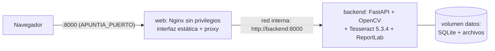

# Arranque con Docker Compose (FULL-13)

Alternativa a los scripts (FULL-11), con la **misma funcionalidad**. Desde la raíz del repositorio:

```bash
docker compose -f fullstack/compose.yaml up --build -d
```

Abre `http://localhost:8000/inicio`. Otros comandos:

```bash
docker compose -f fullstack/compose.yaml logs -f
```

```bash
docker compose -f fullstack/compose.yaml down
```

`down` para los contenedores y **conserva los datos** (volumen `apuntia_datos`). Para borrarlos
también: `docker compose -f fullstack/compose.yaml down -v`.

## 1. Servicios

Solo hay dos, porque solo existen dos componentes (no hay Spring Boot en el repositorio):



| Servicio | Imagen | Qué hace |
|----------|--------|----------|
| `web` | `fullstack/docker/web.Dockerfile` (nginx-unprivileged 1.27) | Sirve `/inicio` y `/front/…` con las mismas cabeceras de seguridad (CSP) que el backend en el modo sin Docker, y reenvía todo lo demás (API, `/salud`, `/analisis`, `/docs`) al backend |
| `backend` | `fullstack/docker/backend.Dockerfile` (Ubuntu 24.04, Python 3.12) | API v1 y v2, OCR, PDF. No se publica fuera de la red interna |

El navegador solo habla con `web`, así que la interfaz y la API comparten origen: la cookie de
sesión funciona, no hace falta CORS y el navegador nunca ve el nombre interno `backend`.

## 2. Decisiones

- **Base Ubuntu 24.04** para el backend: trae Tesseract **5.3.4**, la misma versión con la que se
  midió el OCR, así que los resultados son comparables. Los idiomas `spa` y `eng` (~30 MB) van en la
  imagen: no hay descargas al arrancar. Dependencias de Python fijadas con `constraints.txt`.
- **Datos:** solo `/datos` (base de datos y archivos de usuarios) es persistente, en un volumen;
  nada de usuarios va en la imagen. Copias de seguridad: FULL-23.
- **Seguridad:** usuarios sin privilegios (backend uid 10001, Nginx uid 101), sistema de archivos
  de solo lectura con `/tmp` en memoria, `cap_drop: ALL`, `no-new-privileges`, límites de memoria y
  CPU, contexto de construcción mínimo (`*.Dockerfile.dockerignore`: sin pruebas, datos ni `.env`).
- **Salud real:** ambos servicios tienen `healthcheck` sobre `/salud`; `web` espera a que el
  backend esté sano (`depends_on: condition: service_healthy`). Cierre ordenado con 15–20 s de gracia.
- **Configuración:** `fullstack/config/.env` (la misma que usan los scripts) si existe; si no,
  valores por defecto. No hay secretos en la imagen ni en `compose.yaml`.
- **HTTPS:** la composición sirve HTTP en local. Para publicarla, pon delante un proxy con TLS y
  define `COOKIE_SEGURA=1` y `URL_PUBLICA=https://…` en `fullstack/config/.env`.

## 3. Scripts frente a Docker

| Función | Scripts (FULL-11) | Docker |
|---------|-------------------|--------|
| Mejorar una foto (PNG, v1) | ✔ | ✔ |
| Cuentas, sesión y CSRF | ✔ | ✔ (mismo origen a través de Nginx) |
| Apuntes de varias fotos y OCR | ✔ si Tesseract está instalado en el equipo | ✔ siempre (Tesseract en la imagen) |
| Fórmulas, tablas, PDF | ✔ | ✔ |
| Investigación (Wikipedia) | ✔ con Internet | ✔ con Internet |
| Datos persistentes | `back/motori_magenes/datos/` | volumen `apuntia_datos` |
| Requisitos en el equipo | Python 3.10+ (y Tesseract) | Solo Docker |

## 4. Desarrollo y entrega

- **Entrega:** `up --build -d` construye las imágenes a partir del código del repositorio.
- **Desarrollo:** lo más cómodo es el modo sin Docker (`./iniciar.sh`), que recarga el código al
  reiniciarlo; las imágenes se reconstruyen en segundos si solo cambia el código (las dependencias
  quedan en caché).

## 5. Qué se probó

`npm run test:docker` (`fullstack/tests/docker/docker.test.js`, proyecto aislado `apuntia-prueba`):
ambos servicios `healthy`, OCR con español dentro del contenedor, `GET /` de la v1 intacto,
cabeceras CSP y `X-Frame-Options` en la interfaz, `tests/` y la maqueta no se sirven, backend con
uid 10001; en el navegador, crear una cuenta, subir una foto, ver el texto reconocido y generar el
PDF; tras `down` + `up`, la sesión y el apunte con su PDF siguen. Resultado: 2/2.

Tamaño: backend 856 MB (221 MB comprimida), web 75 MB. Construcción del backend desde cero:
~1,5 min. Nota del entorno de pruebas: la red de ese contenedor solo permitía los repositorios de
Ubuntu a través de un proxy, así que se construyó con una copia del Dockerfile que añadía su
certificado; el Dockerfile del repositorio no lo necesita.
