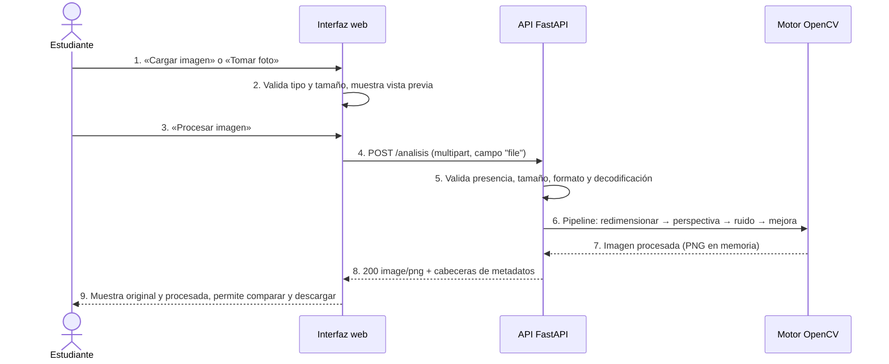
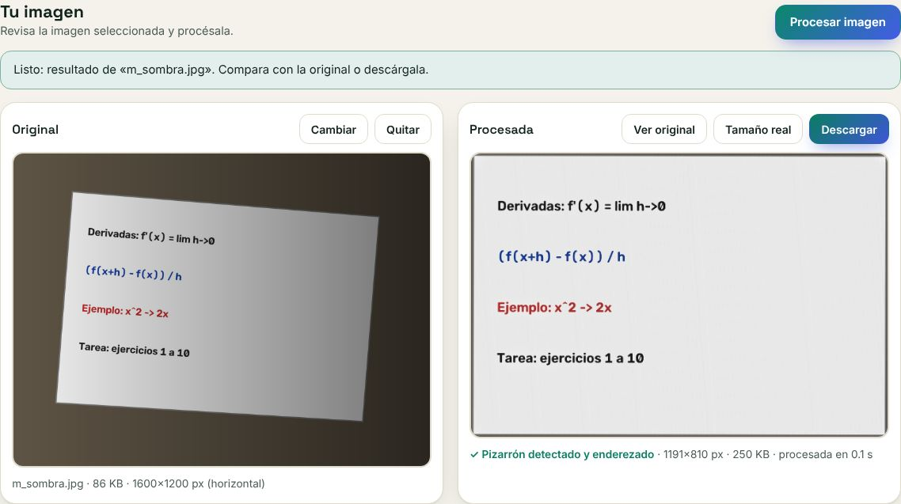
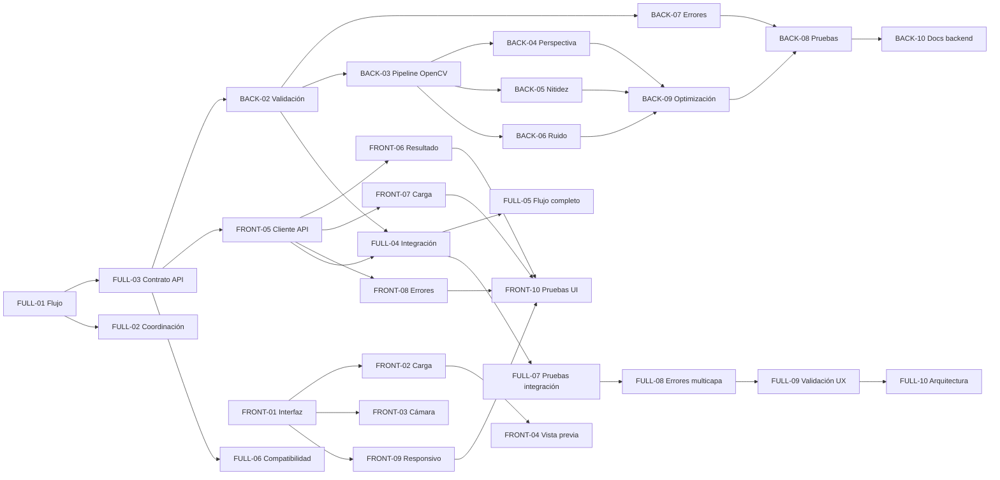

# Flujo completo de ApuntIA (FULL-01)

Este documento traduce el objetivo de ApuntIA, convertir la foto de un pizarrón en una imagen
digital legible, en un recorrido técnico entre la **interfaz**, la **API** y el **procesamiento**.
Es la base para el contrato de la API ([`api.md`](api.md)) y para el resto de issues.

## Actores

| Actor | Rol |
|-------|-----|
| **Estudiante** (usuario) | Fotografía o elige la imagen del pizarrón, la revisa y obtiene el resultado. |
| **Interfaz web** (`index.html` + `front/js`) | Valida la selección, muestra la vista previa, envía la imagen y presenta el resultado o los errores. |
| **API FastAPI** (`back/motori_magenes`) | Valida la petición, ejecuta el procesamiento y responde con la imagen o con un error estructurado. |
| **Motor de procesamiento** (OpenCV) | Decodifica, corrige perspectiva, elimina ruido, mejora contraste y nitidez, y codifica el resultado. |

## Recorrido normal

| Paso | Entrada | Salida | Restricciones |
|------|---------|--------|---------------|
| 1. Elegir imagen | Archivo del dispositivo o foto de la cámara | `File` en memoria del navegador | Cámara solo en contexto seguro (`https` o `localhost`) y con permiso del usuario |
| 2. Validar en el cliente | `File` | Vista previa o mensaje de error | JPEG, PNG o WEBP; máximo 10 MB. Es una ayuda: el backend vuelve a validar todo |
| 3. Confirmar | Clic | Petición en curso | Un envío a la vez: los botones se bloquean |
| 4. Enviar | `multipart/form-data`, campo `file` | Petición HTTP | URL base configurable, sin rutas fijas de una computadora |
| 5. Validar en el servidor | Bytes del archivo | Imagen decodificada o error 4xx | Rechaza archivo ausente, vacío, demasiado grande, de tipo no permitido o corrupto |
| 6. Procesar | Matriz OpenCV | Matriz procesada | El original no se modifica. Si no se detecta el pizarrón, se continúa sin corregir la perspectiva |
| 7–8. Responder | Matriz procesada | `image/png` y cabeceras `X-ApuntIA-*` | Nada se guarda en disco |
| 9. Mostrar | `Blob` | Comparación original/procesada y descarga | Se liberan las URLs temporales |

## Casos de error

| Caso | Dónde se detecta | Respuesta esperada |
|------|------------------|--------------------|
| No se elige archivo o se cancela el selector | Interfaz | Se conserva la selección anterior; sin selección, «Procesar» queda deshabilitado |
| Tipo no admitido (PDF, HEIC, etc.) | Interfaz y API (`415`) | Mensaje con los formatos aceptados y opción de elegir otra imagen |
| Archivo demasiado grande | Interfaz y API (`413`) | Mensaje con el límite y opción de elegir otra imagen |
| Archivo vacío o corrupto | API (`400`) | Mensaje «la imagen no se pudo leer» y opción de elegir otra |
| Permiso de cámara denegado o sin cámara | Interfaz | Explicación y alternativa «Cargar imagen» |
| Servidor apagado o sin red | Interfaz (fallo de `fetch`) | Mensaje de conexión y botón «Reintentar» |
| Tiempo de espera agotado | Interfaz (60 s) | Mensaje y botón «Reintentar» |
| Pizarrón no detectado | Motor | No es un error: se devuelve la imagen mejorada sin corregir la perspectiva y la interfaz lo indica |
| Fallo inesperado del procesamiento | API (`500`) | Mensaje genérico sin trazas técnicas; el detalle queda en el log del servidor |

## Reintentos y resultados anteriores (FULL-05)

| Situación | Comportamiento |
|-----------|----------------|
| Se elige otra imagen (archivo, cámara o arrastre) | Se retiran el resultado y la URL temporal anteriores |
| Se pulsa «Procesar» de nuevo, o «Reintentar» | El resultado anterior se retira **al empezar**: nunca se ve un resultado viejo junto a un error ni durante la espera |
| Falla el procesamiento | Se conserva la imagen elegida y se ofrece «Reintentar» (misma imagen) o «Elegir otra» |
| Se cancela | Se conserva la imagen elegida; el resultado ya se había retirado |
| Durante el procesamiento | No se puede cambiar la imagen (controles bloqueados) |

**El resultado corresponde a la imagen enviada:**
- El controlador guarda el `File` enviado y, al llegar la respuesta, comprueba que siga siendo la imagen seleccionada; si no, descarta la respuesta.
- El mensaje final nombra el archivo («Listo: resultado de «x.jpg»»).
- El servidor confirma el nombre recibido en `X-ApuntIA-Archivo`.

Recorrido verificado con el backend real (Chromium, página en :5500, API en :8000):

| Foto | Tiempo total en la UI | Resultado |
|------|-----------------------|-----------|
| `bd/img/image.png` (real, 516×387) | 1.1 s (primera petición) | No detectado, mejorada · 516×387 |
| Frontal 1200×800 | 0.6 s | No detectado (ya está de frente) · 1200×800 |
| Inclinada 1600×1200 | 0.2 s | ✓ Enderezada · 1191×811 |
| Oscura / con sombra / con ruido | 0.1–0.3 s | ✓ Enderezada · ~1190×810 |
| Sin pizarrón | 0.3 s | No detectado · 1200×900 |
| Celular 12 MP (4032×3024) | 0.8 s | ✓ Enderezada · 1489×1013 |
| Servidor caído → levantarlo → «Reintentar» | — | Error de conexión sin resultado viejo → ✓ resultado |

## Alcance de la primera versión

**Incluye:**
- Carga desde el dispositivo y captura con cámara (en vivo con `getUserMedia`, con `capture` como alternativa).
- Vista previa, procesamiento con OpenCV (perspectiva, ruido, contraste y nitidez) y comparación antes/después con descarga.
- Validación y mensajes de error en las dos capas.
- Diseño para móvil y escritorio.
- Pruebas automáticas de backend, interfaz e integración, y documentación.

**Queda fuera** (posibles versiones futuras): reconocimiento de texto (OCR), cuentas de usuario, historial guardado en el servidor, procesamiento por lotes y formatos HEIC/PDF.

La maqueta `front/maqueta.html` (biblioteca de apuntes, IA simulada) es una referencia de diseño y no forma parte de esta versión.

## Actividades relacionadas y dependencias

## Criterios de entrega

- El usuario completa el recorrido «elegir o tomar foto → procesar → ver resultado» sin pasos manuales externos.
- Cada error de la tabla anterior produce un mensaje visible, entendible y con una acción para resolverlo.
- Las pruebas automáticas de backend (`pytest`), interfaz e integración pasan.
- La documentación permite levantar las dos partes desde cero.

> **Pendiente del equipo:** este flujo es una propuesta. Debe revisarse y acordarse en el issue (FULL-01 pide un «flujo acordado por el equipo»).
