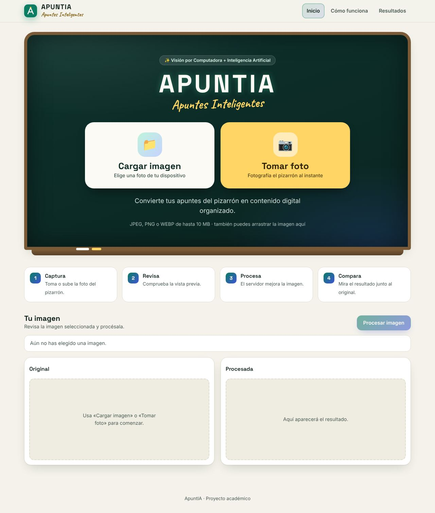
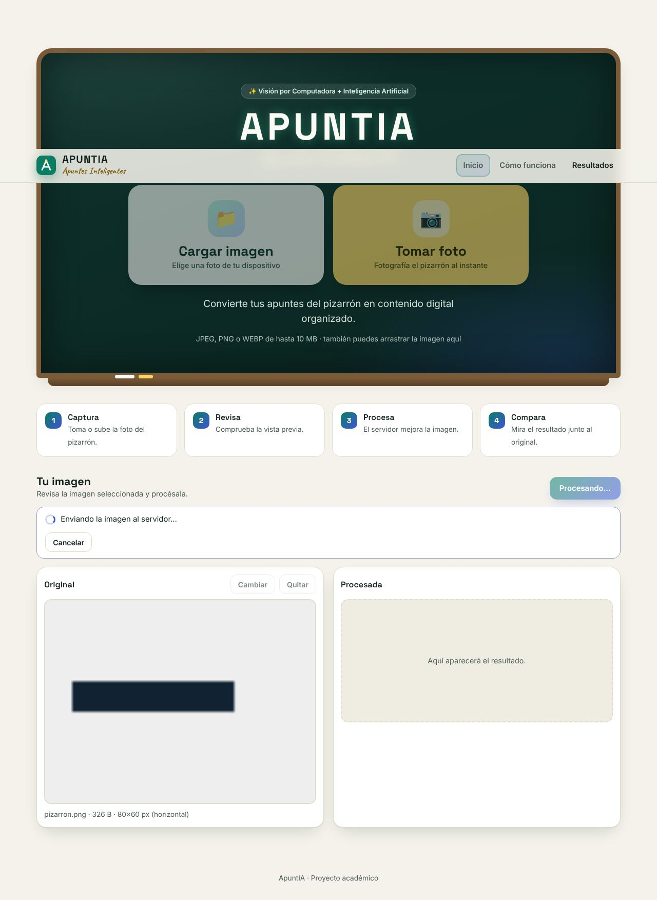
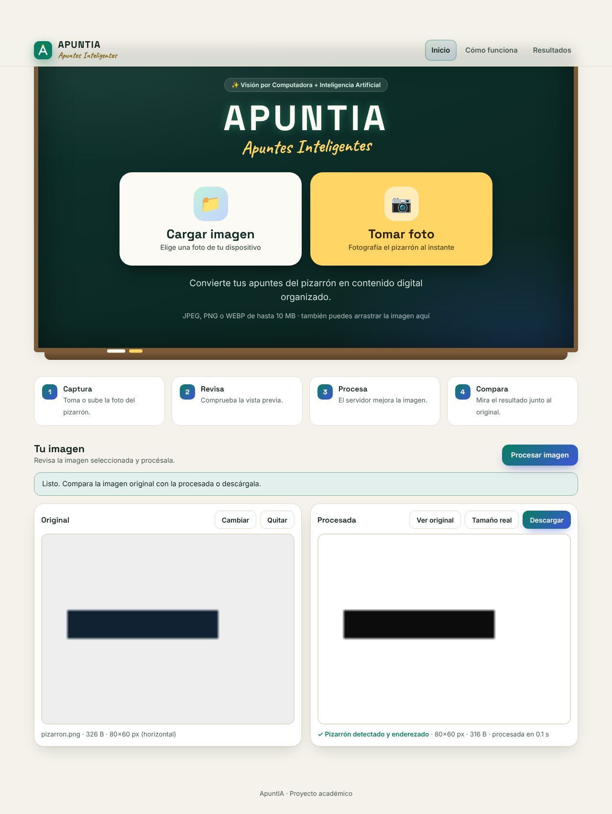
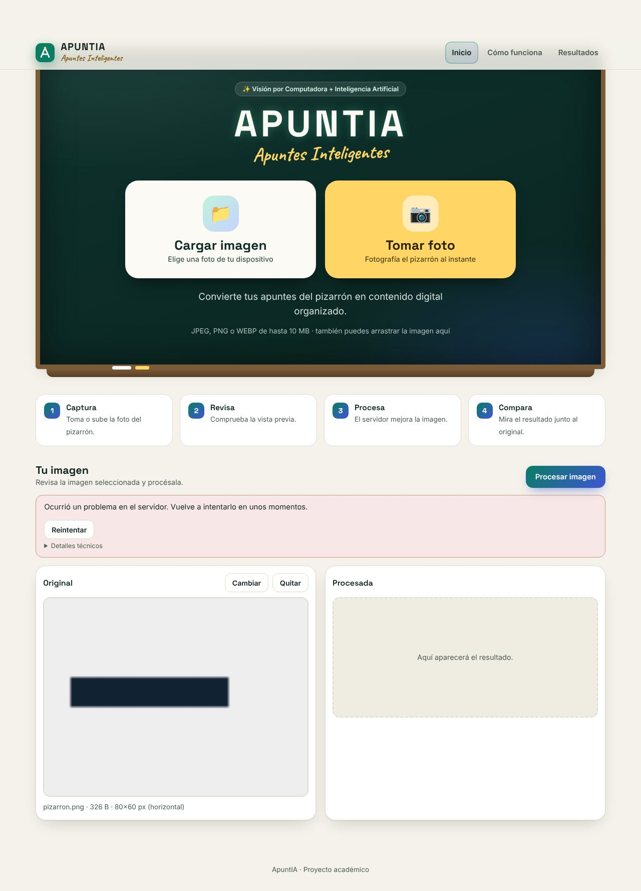
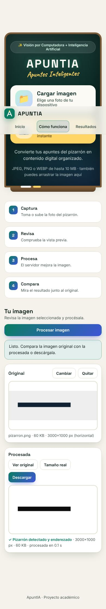

# Pruebas de funcionamiento de la interfaz (FRONT-10)

## Cómo ejecutarlas

Desde la raíz del repositorio (requiere Node.js 22 o superior: `node --test` con patrones necesita Node 21+):

```bash
npm install
```

```bash
npx playwright install chromium
```

```bash
npm run test:front
```

- Las pruebas levantan su propio servidor estático y usan la **API simulada** (`?mock=...`), así que **no necesitan el backend**. Las pruebas contra FastAPI real están en FULL-07.
- Otros navegadores: `npx playwright install firefox webkit` y después `NAVEGADORES=chromium,firefox,webkit npm run test:front`.
- Capturas de evidencia: `CAPTURAS=docs/evidencias npm run test:front`.

Archivo: [`front/tests/interfaz.test.js`](../front/tests/interfaz.test.js) (`node:test` + Playwright).

## Casos de prueba

| ID | Caso | Qué se comprueba | Resultado |
|----|------|------------------|-----------|
| C01 | Estado inicial | «Cargar imagen» y «Tomar foto» visibles; «Procesar» deshabilitado; sin errores de JavaScript | ✅ |
| C02 | Seleccionar con el input | Vista previa visible; nombre, peso, dimensiones y orientación correctos; «Procesar» habilitado | ✅ |
| C03 | Cambiar y quitar | Reemplazo por otra imagen (vertical detectada); «Cambiar» abre el selector; «Quitar» vacía la selección y deshabilita «Procesar» | ✅ |
| C04 | Archivos no válidos | PDF disfrazado de `.png`, archivo vacío y tamaño excedido: mensaje específico y **se conserva la imagen anterior** | ✅ |
| C05 | Cancelar el selector | Sin imagen previa: indica cómo empezar; con imagen: «Se mantiene «x»» | ✅ |
| C06 | Procesar | Spinner, controles bloqueados y `aria-busy`; después, resultado visible con sus datos y controles restaurados | ✅ |
| C07 | Envíos duplicados | Tres clics seguidos → **una** llamada a la API | ✅ |
| C08 | Comparar y descargar | Mantener «Ver original» muestra la original y al soltar vuelve el resultado; la descarga se llama `<nombre>_apuntia.png` | ✅ |
| C09 ×6 | Errores de la API | 415, 413, 400, 500, sin red y respuesta vacía: mensaje del catálogo, acciones correctas, controles restaurados y sin trazas técnicas | ✅ |
| C10 | Reintentar | «Reintentar» reenvía **la misma** imagen | ✅ |
| C11 | Cancelar el procesamiento | «Cancelar» aborta la petición y restaura los controles | ✅ |
| C12 | Cámara denegada | Ofrece «Usar la app de cámara» y «Cargar imagen» | ✅ |
| C13 | Cámara en vivo | Capturar → `foto-AAAAMMDD-HHMMSS.jpg` lista y cámara apagada (solo Chromium, que tiene cámara simulada) | ✅ |
| C14 | Adaptable | Sin scroll horizontal a 320×640, 390×844, 844×390 y 1920×1080 con el resultado en pantalla | ✅ |
| C15 | Teclado | El orden de tabulación coincide con el visual: «Cargar imagen» → «Tomar foto» | ✅ |

**Resultado (Chromium, 3 de noviembre de 2026): 20 de 20 pruebas correctas en unos 45 s.**

## Navegadores

| Navegador | Estado |
|-----------|--------|
| Chromium (Playwright) | ✅ 20/20 |
| Firefox / WebKit (Safari) | ⏳ **No ejecutado**: no estaban instalados en el entorno donde se corrieron las pruebas. La batería los admite (`NAVEGADORES=...`); queda pendiente correrla en el equipo de algún integrante. C13 se omite en ellos porque requiere la cámara simulada de Chromium. |
| Celulares reales (Android/iOS) | ⏳ Pendiente de prueba manual: ver la lista de validación en FULL-09. |

## Incidencias registradas durante el desarrollo del frontend

Detectadas al probar cada issue y **ya corregidas**:

| Issue | Incidencia | Corrección |
|-------|-----------|------------|
| FRONT-01 | «Cómo funciona» se partía en dos líneas en el móvil | `white-space: nowrap` en la navegación |
| FRONT-03 | El visor heredado (`object-fit: cover`) recortaba el video: la foto incluía zonas que no se veían | `object-fit: contain` |
| FRONT-05 | El navegador no puede leer las cabeceras `X-ApuntIA-*` del backend real: falta `Access-Control-Expose-Headers` | Pendiente en el backend; se corrige en **FULL-04** |
| FRONT-06 | Al comparar, el cambio de `src` volvía a disparar `onload` y sobrescribía los datos con los de la original | Los manejadores se desactivan tras la primera carga |
| FRONT-07 | El contador de segundos dentro de `role="status"` se anunciaría cada segundo en el lector de pantalla | Reloj `aria-hidden`; solo se anuncian los cambios de fase |
| FRONT-09 | Botones de 38 px en pantallas táctiles | 44 px con `pointer: coarse` |
| FRONT-09 | «Tomar foto» recibía el foco antes que «Cargar imagen» | Input movido junto a su etiqueta |
| FRONT-09 | El encabezado fijo tapaba media pantalla en el móvil en horizontal | Encabezado estático con alto ≤ 500 px |

## Capturas

| Inicio | Procesando | Resultado |
|---|---|---|
|  |  |  |

| Error del servidor | Móvil (390×844) |
|---|---|
|  |  |
