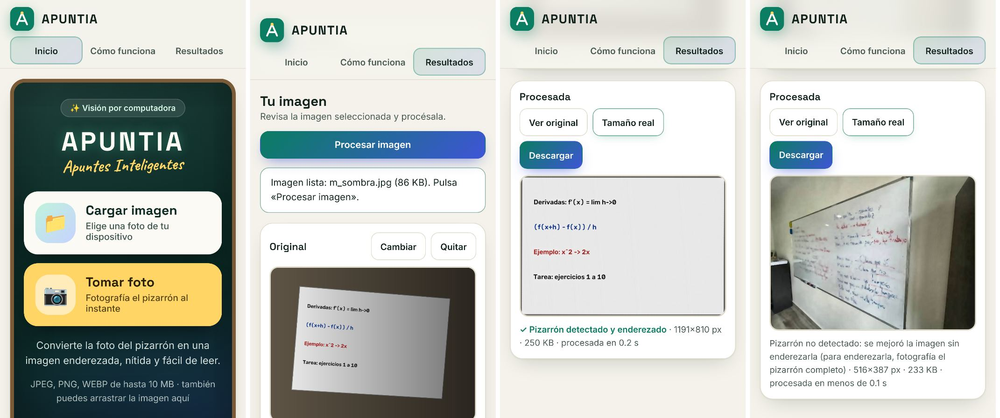

# Validación del funcionamiento completo y la experiencia de usuario (FULL-09)

## Cómo se hizo y qué falta

- **Hecho:** recorrido completo **desde la interfaz**, solo con lo que ve el usuario (sin consola ni `/docs`), contra el backend real, en **dispositivos emulados** con Playwright: iPhone 13, Pixel 7, iPad Mini y escritorio a 1366×768, con imágenes difíciles. Cada pantalla se revisó con capturas.
- **Pendiente (lo debe hacer el equipo):** el mismo recorrido **en celulares reales** (al menos un Android y un iPhone) por alguien que no haya desarrollado la aplicación, siguiendo la lista de la sección 4 y [`ejecutar.md`](ejecutar.md#2-abrir-el-frontend) (opción c, en la red local). La emulación no sustituye a la cámara real, al permiso del sistema ni a la luz real de un aula.

## 1. Lista de validación (dispositivos emulados)

| # | Criterio | iPhone 13 | Pixel 7 | iPad Mini | Escritorio |
|---|----------|:--:|:--:|:--:|:--:|
| V1 | Se entiende qué hace la app y qué hacer primero (2 acciones visibles sin desplazar) | ✅ | ✅ | ✅ | ✅ |
| V2 | Tras elegir la foto se ve la vista previa y un mensaje claro de qué hacer después | ✅ | ✅ | ✅ | ✅ |
| V3 | La espera se entiende: spinner y fase, sin porcentajes inventados | ✅ | ✅ | ✅ | ✅ |
| V4 | **El resultado queda a la vista al terminar, sin buscarlo** | ✅ (tras M1) | ✅ | ✅ | ✅ |
| V5 | Se sabe si el pizarrón se enderezó y, si no, qué hacer | ✅ (tras M3) | ✅ | ✅ | ✅ |
| V6 | Se puede comparar con la original y descargar | ✅ | ✅ | ✅ | ✅ |
| V7 | Los errores dicen qué pasó y ofrecen una salida (ver [`pruebas-integracion.md`](pruebas-integracion.md)) | ✅ | ✅ | ✅ | ✅ |
| V8 | El texto no promete funciones que no existen | ✅ (tras M2) | ✅ | ✅ | ✅ |
| V9 | Sin desbordamientos; botones táctiles ≥ 44 px (ver FRONT-09) | ✅ | ✅ | ✅ | ✅ |

## 2. Imágenes difíciles

| Imagen | Resultado | Valoración |
|--------|-----------|------------|
| Pizarrón inclinado | Enderezado, texto horizontal | ✅ Buena |
| Foto oscura | Enderezado; contraste de 69 → 156 | ✅ Buena |
| Sombra lateral fuerte | Enderezado; iluminación uniforme | ✅ Buena (bandas muy tenues en degradados extremos) |
| Ruido de cámara / sal y pimienta | Enderezado; ruido eliminado sin borrar trazos | ✅ Buena |
| Celular 12 MP | Enderezado en ~0.3 s de servidor; descarga de 165 KB | ✅ Buena |
| **Foto real `bd/img/image.png`**: pizarrón cortado por el encuadre, blanco sobre pared blanca | **No se endereza**; solo mejora moderada; la interfaz da el consejo | ⚠️ Limitación conocida (BACK-04) |
| Foto sin pizarrón | No detectado; se devuelve mejorada | ✅ Comportamiento correcto |
| Foto vertical de celular (EXIF) | Misma orientación en la vista previa y en el resultado | ✅ |
| HEIC (iPhone) | Rechazada con instrucciones para exportar como JPEG | ⚠️ Fuera del alcance v1 |

## 3. Tiempos de espera (backend local)

| Caso | Tiempo de servidor | Tiempo percibido en la interfaz |
|------|--------------------|----------------------------------|
| Foto pequeña (516×387) | < 0.1 s | ~0.1–0.4 s |
| 1600×1200 | 0.1 s | ~0.3 s |
| 12 MP | 0.3 s | ~0.8–1.4 s (incluye subir 2–3 MB) |

Por una red Wi-Fi real hay que sumar la subida de la foto (de 2 a 5 MB en un celular). Para eso existen los mensajes de espera larga y «Cancelar».

## 4. Lista para la validación en dispositivos reales (pendiente)

Para cada dispositivo, marcar ✅ / ❌ y anotar observaciones:

- [ ] Abrir `http://<ip-del-pc>:5500/index.html` desde el celular.
- [ ] «Tomar foto» abre la cámara del celular, se toma la foto del pizarrón del aula y aparece la vista previa.
- [ ] «Cargar imagen» con una foto de la galería.
- [ ] Procesar: el resultado aparece a la vista y el texto es más legible que en la original.
- [ ] «Ver original», «Tamaño real» y «Descargar» funcionan; la descarga se abre en la galería o en los archivos.
- [ ] Con el Wi-Fi apagado: el mensaje de conexión es claro y «Reintentar» funciona al volver a conectarse.
- [ ] Foto HEIC (iPhone): el mensaje explica qué hacer.
- [ ] En horizontal: todo sigue siendo usable.
- [ ] Opinión de la persona: ¿entendió qué hacer sin ayuda? ¿Qué le confundió?

## 5. Mejoras

### Aplicadas en este issue

| # | Problema detectado | Prioridad | Cambio |
|---|--------------------|-----------|--------|
| M1 | En el celular, al terminar solo se veía la original: el resultado quedaba debajo, fuera de la pantalla, y nada lo indicaba | **Alta** | Se desplaza automáticamente hasta el panel del resultado (suave, salvo con `prefers-reduced-motion`), con margen para el encabezado fijo |
| M2 | La portada prometía «contenido digital organizado» e «Inteligencia Artificial», pero la v1 no tiene OCR | **Alta** (expectativas) | «Convierte la foto del pizarrón en una imagen enderezada, nítida y fácil de leer» · «Visión por computadora» |
| M3 | Si el pizarrón no se detectaba, no se decía cómo conseguirlo | Media | Consejo en la línea de datos: «fotografía el pizarrón completo» |
| M4 | «procesada en 0.0 s» | Baja | «procesada en menos de 0.1 s» |

### Priorizadas para después (fuera del alcance v1)

| Prioridad | Mejora | Motivo |
|-----------|--------|--------|
| 1 | Ajuste manual de las 4 esquinas cuando no se detectan | Resolvería el caso de la foto real (pizarrón cortado o sin contraste con la pared) |
| 2 | Detección del marco con rectas de Hough | Lo mismo, de forma automática |
| 3 | Admitir HEIC en el backend (`pillow-heif`) | Fotos de iPhone sin pasos extra |
| 4 | Reducir la foto en el navegador antes de subirla (≤ 2000 px) | Menos espera por Wi-Fi o datos móviles; el backend la reduce igual |
| 5 | OCR del texto | El objetivo original de «apuntes digitales» |

## 6. Alcance entregable confirmado

La **v1** cumple el recorrido principal definido en [`flujo.md`](flujo.md): elegir o tomar una foto → vista previa → procesar (perspectiva, ruido, contraste, nitidez) → comparar y descargar, con errores comprensibles en cada paso.

- **Fallas críticas:** ninguna abierta.
- **Limitaciones documentadas:** pizarrones que no se ven completos y formato HEIC.
- **Pendiente para dar el issue por cerrado:** la validación en celulares reales (sección 4).

