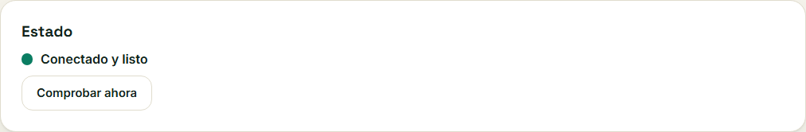
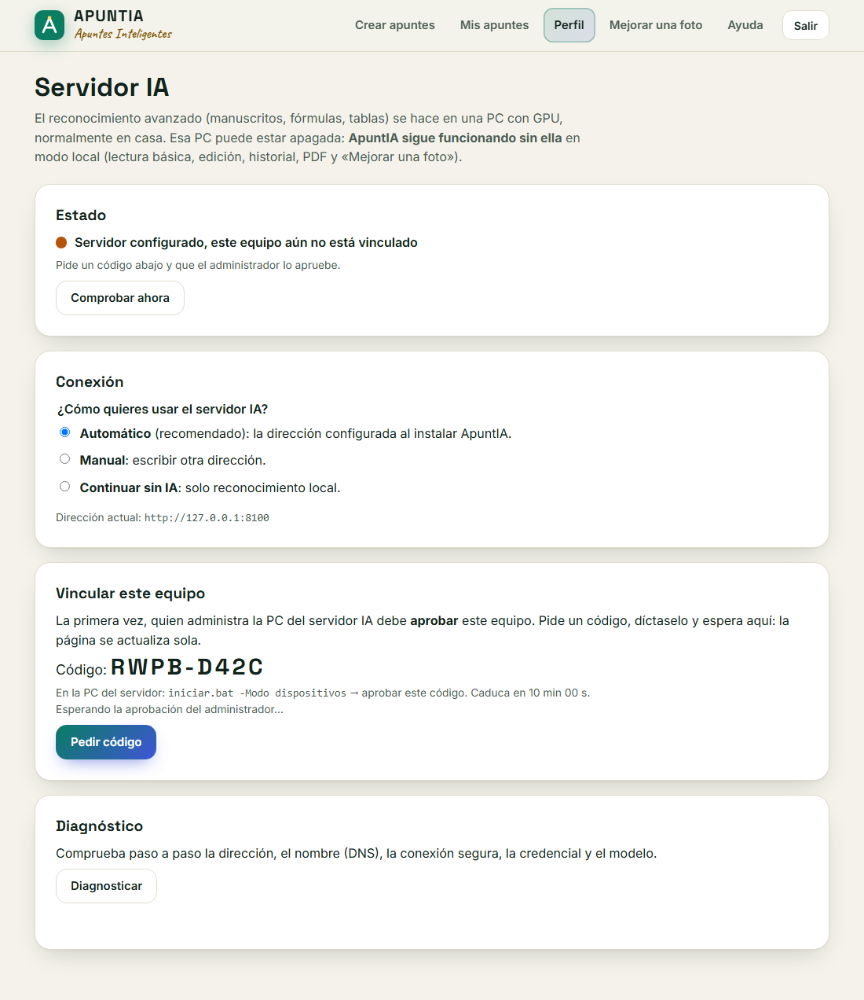
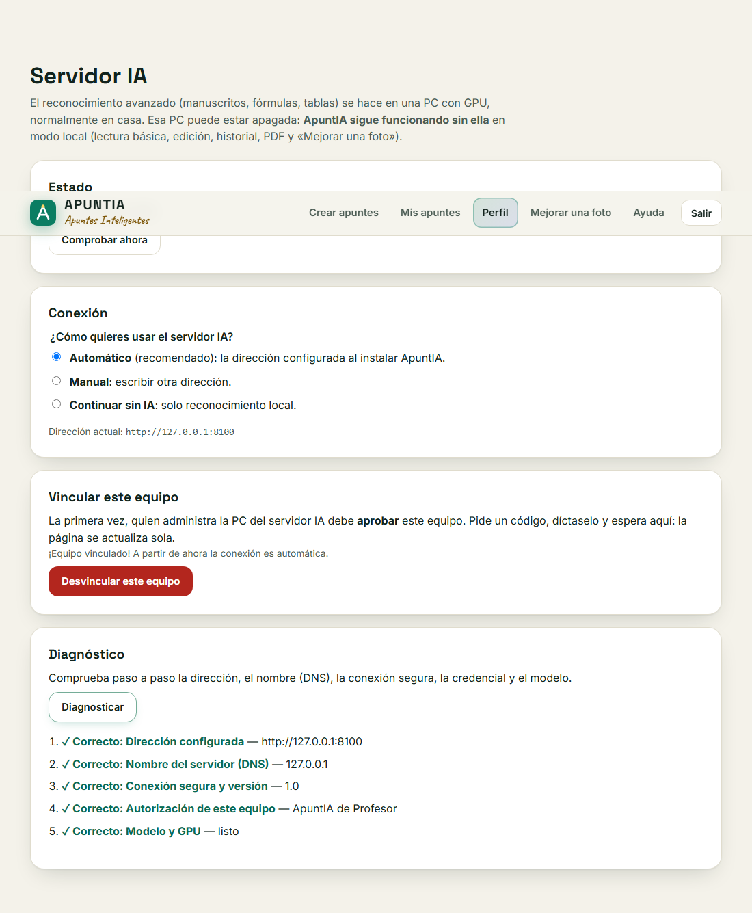
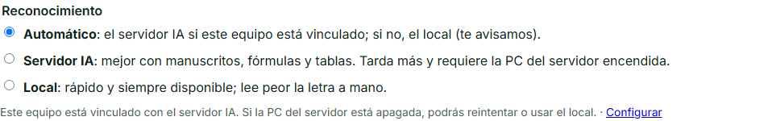

# Interfaz de conexión con el servidor IA (FRONT-25)

Pantalla **Servidor IA** (`/front/ia.html`, enlazada desde *Perfil* y desde *Crear apuntes*) y el
selector de reconocimiento de *Crear apuntes*. Lo que ocurre detrás (vinculación, credencial,
túnel): [conexion-remota.md](../../fullstack/docs/conexion-remota.md). Estados y mensajes:
[ESTADOS_Y_ERRORES.md](ESTADOS_Y_ERRORES.md).

## Secciones de la pantalla

| Sección | Qué hace | API (backend LOCAL) |
|---------|----------|---------------------|
| Estado | Indicador con **texto** y color (`role=status`, `aria-live`); «Comprobar ahora» lanza una comprobación | `GET /api/v2/ia/estado`, `GET /api/v2/ia/diagnostico` |
| Conexión | Automático (dirección de la instalación) · Manual (URL validada) · Continuar sin IA | `PUT /api/v2/ia/configuracion {modo, url}` |
| Vincular este equipo | «Pedir código» muestra el código y la cuenta atrás; consulta cada 3 s hasta aprobado, rechazado o caducado | `POST`/`GET /api/v2/ia/vinculacion` |
| Desvincular | Diálogo de confirmación; recuerda pedir la revocación al administrador si el equipo se perdió | `DELETE /api/v2/ia/vinculacion` |
| Diagnóstico | Lista paso a paso (✓ Correcto / ✗ Falla) con «Qué hacer» en cada fallo | `GET /api/v2/ia/diagnostico` |

En *Crear apuntes*, el grupo **Reconocimiento** ofrece Automático (por defecto), Servidor IA o
Local. Si el equipo no está vinculado, «Servidor IA» queda deshabilitado y se explica por qué, con
un enlace a «Configurar». El editor muestra las etapas remotas («En cola en el servidor IA», «El
servidor IA está leyendo la foto… 40 %»), permite cancelar y, si el servidor IA falla, ofrece
**Reintentar el análisis** (retoma sin repetir) y **Analizar en modo local**.

## Reglas de seguridad de la interfaz

- El navegador **nunca** recibe el token del equipo; tampoco se guardan URL ni estado en
  `localStorage`/`sessionStorage` (lo comprueba `v2-ia.test.js`).
- Las acciones que cambian algo solo funcionan en el equipo donde corre ApuntIA: desde otro
  dispositivo de la red (`iniciar.bat -Red`) la pantalla lo explica y deshabilita los controles
  (`puede_configurar: false`).
- Todas las peticiones usan la sesión y la cabecera CSRF de siempre (`nucleo.js` → `pedir`);
  sin scripts en línea (CSP).

## Accesibilidad y uso

- Estado y mensajes en regiones `status`/`alert` con `aria-live`; los errores de la URL van en el
  propio campo (`aria-invalid` + `aria-describedby`) y el foco vuelve a él.
- Grupos de opciones con `fieldset`/`legend`, navegables con flechas.
- Sin sondeo agresivo: una comprobación al abrir y otra al pulsar el botón; el sondeo de la
  vinculación se detiene al caducar el código o al salir de la página.
- Animación del punto de estado desactivada con `prefers-reduced-motion`.
- Probado a 320 px sin desbordamiento horizontal.

## Pruebas

`fullstack/tests/integracion/v2-ia.test.js` (Playwright contra el backend real): estado local,
URL insegura rechazada en el campo, https aceptada → «sin vincular», diagnóstico con DNS caído y
su solución, modo local y vuelta a automático, selector de *Crear apuntes* deshabilitado sin
vinculación, móvil 320 px con teclado, enlace desde Perfil y ningún secreto en el almacenamiento
del navegador. Evidencias con el servidor IA real: ver [ESTADOS_Y_ERRORES.md](ESTADOS_Y_ERRORES.md#evidencias).

## Capturas de la sesión real (14/11/2026)

Servidor IA real en la PC (RTX 3060, `qwen3-vl:8b-instruct`), backend real, cuenta de prueba:

