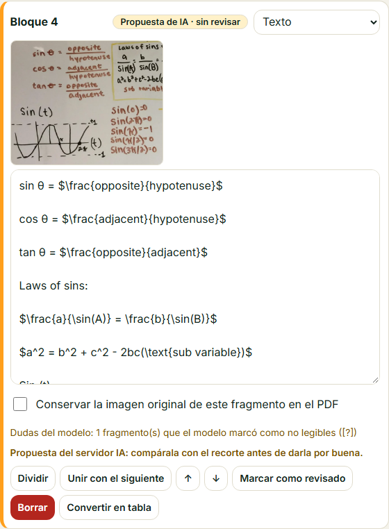
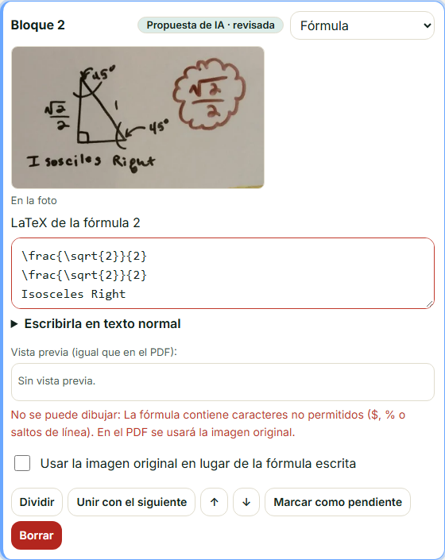

# Editor de revisión de propuestas del servidor IA (FRONT-26)

El editor (`/front/editor.html`, `js/v2/editor*.js`) ya mostraba recortes, alternativas, motivos de
revisión, fórmulas con vista previa y tablas editables (FRONT-13/14, BACK-28). FRONT-26 añade el
tratamiento de los bloques que vienen del **servidor IA** (`procedencia.motor = "ia_remota"`), que
son una **propuesta** y nunca se presentan como transcripción confirmada.

## Qué ve la persona

| Elemento | Bloque del servidor IA | Bloque del OCR local |
|----------|------------------------|----------------------|
| Etiqueta | «Propuesta de IA · sin revisar» / «· revisada» / «IA: sin leer» (sin porcentaje: un VLM no da confianza calibrada) | «Reconocido 92 %», «Incierto…» |
| Recorte de la foto | **Siempre**, junto al texto o la fórmula | Solo si es dudoso, manuscrito o imagen |
| Dudas | «Dudas del modelo: …» (lo que el modelo marcó con `[?]`) | «Palabras dudosas: …» |
| Aviso | «Compárala con el recorte…»; en fórmulas, los símbolos que se confunden (6/8, +/−, i/j/k, exponentes y subíndices) | Motivo de revisión de BACK-28 |
| Acción | **Marcar como revisado / pendiente** (se guarda como `revisado`) · Volver al texto reconocido | Otras lecturas · Volver al texto reconocido |
| Marco | Borde azul (`.propuesta-ia`, `data-origen="ia"`, `data-revisado`) | Según su estado |

Las tres procedencias siguen separadas: **extraído de la foto** (`origen: "ocr"`, con
`texto_original` intacto), **corregido por ti** (etiqueta «corregido», `editado`) y **añadido por
investigación** (ampliaciones aparte, BACK-18/38). Marcar como revisado no cambia la procedencia ni
el motivo de revisión: el servidor los conserva (`fusionar`).

## Flujo de corrección

1. Comparar el texto o la fórmula con su recorte; corregir lo necesario (la fórmula se valida y se
   previsualiza con el motor del editor; si no se puede dibujar, se puede conservar el recorte).
2. «Marcar como revisado». Guardar (`PUT` con `If-Match`; los conflictos y la sesión caducada se
   gestionan como siempre).
3. Si algo quedó «IA: sin leer», escribirlo a mano o conservar el recorte como imagen.
4. Si la lectura no convence, «Volver al texto reconocido» o, desde el aviso del análisis,
   re-analizar en modo local: se crea una versión nueva y las correcciones quedan en el historial.

## Accesibilidad

El estado del bloque es texto (no solo color); el botón de revisión usa `aria-pressed`; los
recortes tienen `alt` con el número de bloque; el editor no desborda a 360 px (probado).

## Pruebas

`fullstack/tests/integracion/v2-editor-ia.test.js` (Playwright, backend real y un servidor IA
falso con el mismo contrato, `ia-falsa.js`): etiquetas sin porcentajes, recorte en los tres bloques,
dudas y aviso de símbolos, «Marcar como revisado» guardado y conservado al recargar sin cambiar
`procedencia` ni `revision`, y vista móvil. Backend: `test_analisis_remoto.py`.

## Pendiente

Tablas y diagramas con estructura (celdas, nodos y aristas) dependen de que el servidor IA las
devuelva estructuradas (BACK-36: hoy la tabla se lee como texto con « | »). La comparación lado a
lado foto completa ↔ región resaltada con zoom queda para una iteración posterior.

## Sesión real con la foto del pizarrón (14/11/2026)

Foto real → servidor IA real (`qwen3-vl:8b-instruct`, RTX 3060) → editor: 17 propuestas en 25 s
(modelo ya cargado), 3 regiones «IA: sin leer» (tiras del marco). Capturas:

Hallazgos reales (no ocultados):
- La segmentación automática unió varias zonas en un bloque (definiciones, ley de senos y la
  gráfica) y el modelo leyó «2bc(\text{sub variable})» donde dice «2bc(cos(A))»: por eso la propuesta
  nunca se presenta como confirmada y siempre va junto a su recorte.
- Una región devolvió varias líneas de LaTeX y un título en un único bloque «fórmula»; el editor
  admite una fórmula por bloque y no la puede dibujar (en el PDF se usaría la imagen). Además el
  título salió con la ortografía corregida («Isosceles»). **Corregido en BACK-38**: las regiones
  multilínea se dividen en un bloque por fórmula y las líneas de texto quedan en bloques de texto
  (mismo recorte); ver [trazabilidad-contenido.md](../../fullstack/docs/trazabilidad-contenido.md) §3.
