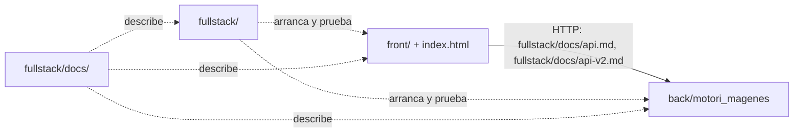

# `fullstack/`: herramientas transversales de ApuntIA

Aquí vive lo que **une** el frontend y el backend: arranque y detención, contenedores, configuración compartida y pruebas de integración.
**No** contiene código de la aplicación: el frontend sigue en `index.html` y `front/`, y el backend en `back/motori_magenes/`.

## Estructura

```
fullstack/
├── README.md               # Este archivo
├── config/
│   └── .env.example        # Variables de toda la aplicación (puertos, datos, OCR, límites)
├── scripts/                # iniciar/detener .sh y .ps1 sin Docker (FULL-11), copias de seguridad (FULL-23)
├── compose.yaml            # Docker Compose: backend + web (FULL-13)
├── docker/                 # Dockerfiles, .dockerignore y nginx.conf (FULL-13)
├── tests/
│   ├── integracion/        # Pruebas frontend + backend reales (antes en tests/integracion/)
│   ├── scripts/            # Pruebas de los scripts de arranque (npm run test:scripts)
│   └── docker/             # Prueba de humo de Docker Compose (npm run test:docker)
└── evaluacion/             # Banco de muestras y métricas de OCR, fórmulas y PDF (FULL-19)
```

Las subcarpetas `scripts/`, `docker/` y `evaluacion/` se añaden en sus issues; esta estructura es la acordada para ellas.

## Reglas de ubicación

| Si el archivo… | Va en |
|----------------|-------|
| Es código de la interfaz (HTML, CSS, JS de la página) o sus pruebas con la API simulada | `index.html`, `front/`, `front/tests/` |
| Es código del backend o sus pruebas unitarias (pytest) | `back/motori_magenes/` |
| Arranca, detiene o empaqueta **varias** partes a la vez | `fullstack/scripts/` o `fullstack/docker/` |
| Prueba el frontend **y** el backend reales juntos | `fullstack/tests/integracion/` |
| Es documentación de producto, contratos, arquitectura o decisiones transversales | `fullstack/docs/` (una sola copia; aquí solo se enlaza) — ver [ESTRUCTURA_DOCUMENTAL.md](docs/ESTRUCTURA_DOCUMENTAL.md) |
| Es documentación solo de la interfaz (pantallas, pruebas de UI, accesibilidad) | `front/docs/` |
| Es la ficha, el plan o la bitácora de un Issue | `fullstack/tickets/` (ver [tickets/README.md](tickets/README.md)) |
| Es un lanzador que el usuario ejecuta | Raíz del repositorio (`iniciar.*`, `detener.*`), que llama a `fullstack/scripts/` |

## Comandos públicos (no cambian)

| Comando | Qué hace |
|---------|----------|
| `npm run test:front` | Pruebas de interfaz (`front/tests/`) |
| `npm run test:integracion` | Pruebas de integración (`fullstack/tests/integracion/`) |
| `python -m pytest` (en `back/motori_magenes`) | Pruebas del backend |

## Dependencias entre módulos



| Carpeta | Responsable (área de los issues) |
|---------|----------------------------------|
| `front/`, `index.html` | Frontend (FRONT-*) |
| `back/motori_magenes/` | Backend (BACK-*) |
| `fullstack/`, `fullstack/docs/` | Full stack (FULL-*) |

## Migración desde la estructura anterior

| Antes | Ahora | Compatibilidad |
|-------|-------|----------------|
| `tests/integracion/` | `fullstack/tests/integracion/` | `npm run test:integracion` se mantiene; documentación y CI actualizadas |
| `docs/` (raíz) | `fullstack/docs/` (FULL-29, `git mv`: conserva el historial) | Enlaces internos, comentarios, pruebas y CI actualizados; no queda copia en `docs/` |
| `docs/interfaz-v2.md`, `docs/pruebas-frontend.md`, `docs/pruebas-interfaz.md` | `front/docs/` (FULL-29) | Ídem; las capturas siguen en `fullstack/docs/evidencias/` |
