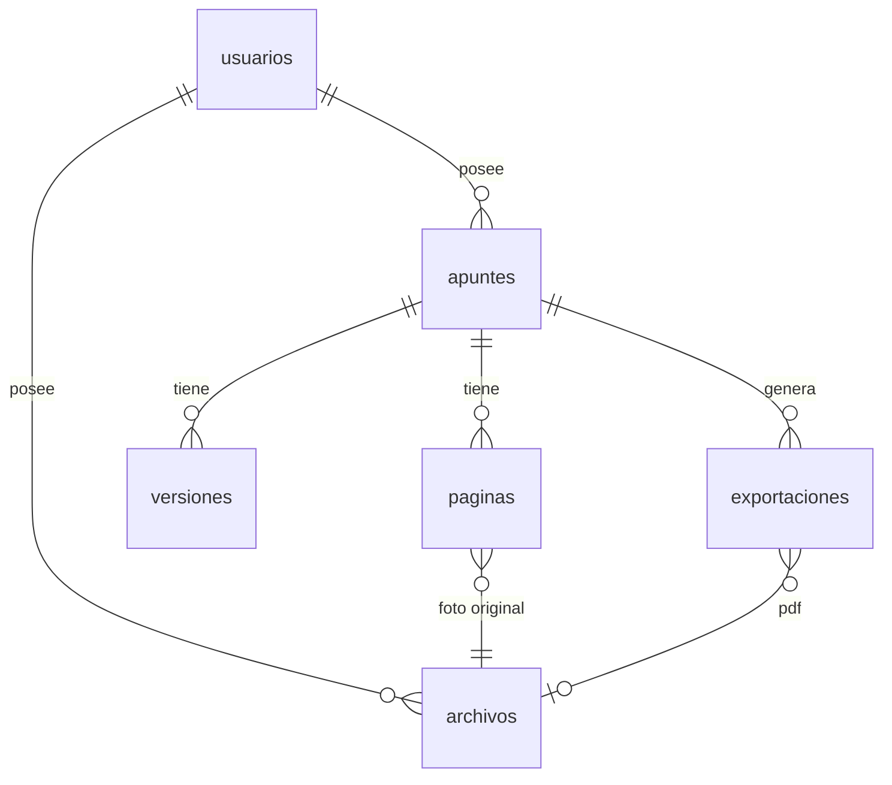

# Datos: base de datos, archivos privados y migraciones

## Tecnología (BACK-22)

- **SQLite** (incluida en Python, sin servidor aparte) en `DATA_DIR/apuntia.sqlite3`. El acceso está aislado en `back/motori_magenes/app/datos/`, así que migrar a PostgreSQL afectaría solo a ese paquete.
- **Archivos privados** en `DATA_DIR/archivos/<usuario>/<id>`: sin extensión ni nombre original, escritos de forma atómica (temporal + `rename`) y **nunca** servidos como estáticos. Solo se entregan desde rutas de la API que comprueban al propietario.
- `DATA_DIR` vale por defecto `back/motori_magenes/datos/` y está en `.gitignore`.

## Esquema

| Tabla | Contenido |
|-------|-----------|
| `usuarios` | email (único, sin distinguir mayúsculas), nombre, hash de la contraseña, preferencias (JSON) |
| `apuntes` | título, estado, tipo de fuente, versión actual, texto para la búsqueda, clave de idempotencia |
| `paginas` | orden y tipo de fuente de cada foto, con su archivo original |
| `versiones` | instantáneas **inmutables** del documento (JSON validado), con el motivo del cambio |
| `archivos` | metadatos de cada archivo privado: tipo, MIME, tamaño, SHA-256 y ruta relativa |
| `exportaciones` | PDF generado a partir de una versión concreta (una por versión) |
| `schema_migraciones` | migraciones aplicadas, con su SHA-256 |

| `sesiones`, `tokens_recuperacion`, `intentos_login` | Migración 0002 (BACK-23): sesiones (solo el hash del token), recuperación de contraseña y control de fuerza bruta |
| `trabajos` | Migración 0003 (BACK-27): procesos largos con estado, etapa, progreso, intentos, resultado y error |
 Borrar un usuario borra en cascada sus apuntes, versiones y metadatos de archivos.

## Migraciones

- Archivos `back/motori_magenes/app/datos/migraciones/NNNN_nombre.sql`, aplicados en orden al arrancar la API.
- Cada migración se aplica en **una transacción**: si falla, se revierte completa y el arranque se detiene con un error que nombra el archivo.
- Las migraciones aplicadas se registran con su **SHA-256**. Si se modifica una ya aplicada, el arranque falla con «cambió después de aplicarse»: los cambios de esquema se hacen siempre con una migración **nueva**.
- Son repetibles: ejecutarlas otra vez no aplica nada.

## Copias de seguridad y recuperación

Ver [`fullstack/docs/respaldo.md`](respaldo.md): copias consistentes con la app en marcha, restauración verificada, copia automática antes de migrar y plan ante una migración fallida.
