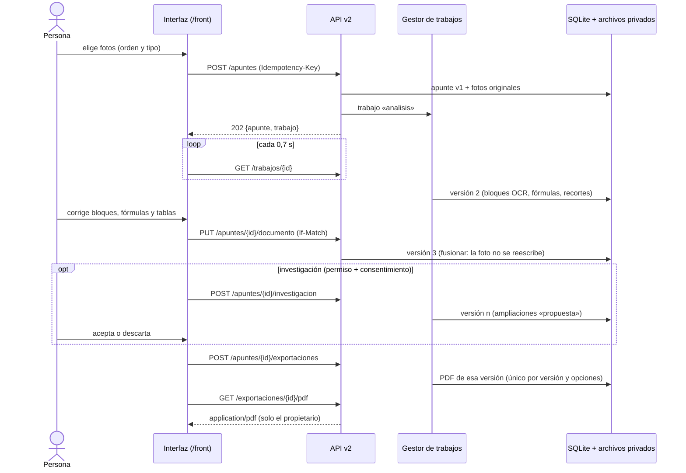
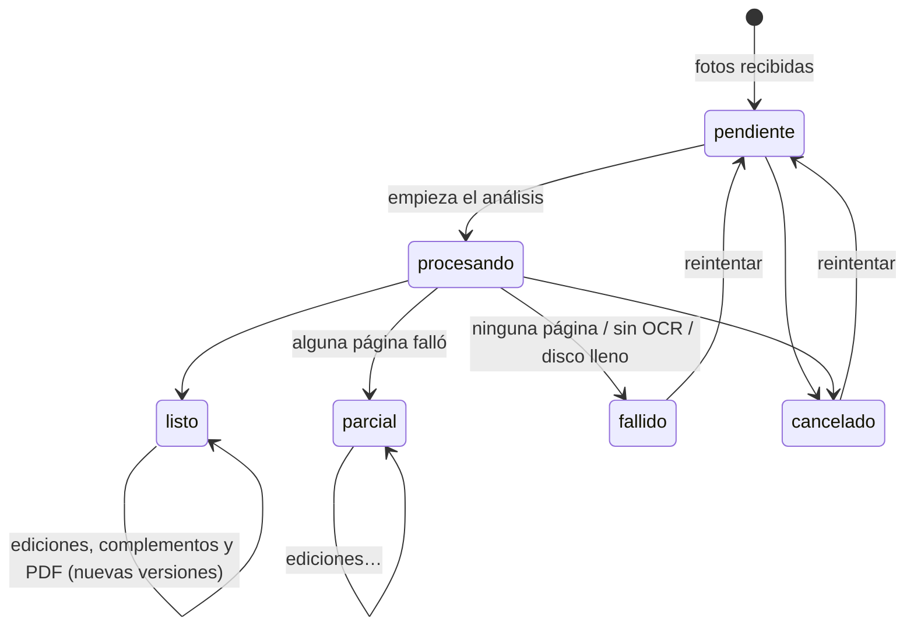

# Flujo completo: de la foto al PDF (FULL-16)

Cómo se encadenan la interfaz, la API, los trabajos, el almacenamiento y el PDF. Cada pieza está
en su issue (BACK-11…27, FRONT-11…22); este documento describe cómo encajan.

## 1. Recorrido

`POST /analisis` (v1) sigue igual y aparte: una foto entra, una PNG sale, nada se guarda.

## 2. Estados

**Apunte** (lo que ve «Mis apuntes»):

**Trabajo** (`analisis`, `investigacion` o `exportacion`): `pendiente → procesando → completado | parcial | fallido | cancelado`,
con `etapa` dentro de `procesando`:

| Etapa | Trabajo | Qué pasa |
|-------|---------|----------|
| `ocr` | análisis | Por página: preprocesado → OCR → manuscritos → fórmulas → recortes |
| `estructurando` | análisis, exportación | Se arma el documento o el apunte estructurado |
| *(revisión)* | — | No es un trabajo: el apunte está `listo`/`parcial` y la persona edita |
| `investigando` | investigación | Opcional; nunca bloquea el PDF |
| `maquetando` | exportación | ReportLab genera el PDF |

Un fallo técnico nunca es un `completado` con contenido fingido: OCR ausente → `fallido` con
`OCR_NO_DISPONIBLE`; una página ilegible → `parcial` con la página señalada; disco lleno →
`ALMACENAMIENTO_LLENO`. La interfaz muestra la causa y «Reintentar», que reutiliza **el mismo**
trabajo (`POST /trabajos/{id}/reintentar`): no se duplican apuntes ni PDF.

## 3. Identificadores

| Id | Forma | Dónde nace | Uso |
|----|-------|-----------|-----|
| apunte | 32 hex aleatorios | `POST /apuntes` | URL del editor (`?id=`) |
| página | `p1`, `p2`… en el orden enviado | creación | `bloques[].pagina`, visor |
| bloque OCR | `p{n}b{m}` | análisis | regiones de la foto, edición |
| bloque añadido | `u…` (base 36) | interfaz | origen `usuario` |
| ampliación | `a` + 16 hex (concepto + URL) | investigación | idempotente: no se duplica |
| versión | 1, 2, 3… | cada guardado | `If-Match`, historial, PDF |
| trabajo | 32 hex | API | progreso, cancelar, reintentar |
| exportación | 32 hex | API | única por (apunte, versión, opciones) |
| archivo | aleatorio | almacén | solo vía rutas que comprueban propietario |

**Correlación en el log:** al terminar cada trabajo se escribe una línea
`trabajo=… tipo=… apunte=… version=… exportacion=… estado=… codigo=… error_id=… ms=…`, sin texto
del apunte, conceptos, nombres de archivo ni datos de la cuenta.

## 4. Reglas que garantizan el resultado

- **La corrección prevalece:** el PDF y la vista previa se generan desde la versión guardada; el
  editor guarda antes de exportar. `fusionar()` impide reescribir lo que dijo la foto
  (`texto_original`, `bbox`, `confianza`, recortes), así que siempre se puede volver a ello.
- **Nada se inventa:** bloques ilegibles, fórmulas no verificables y esquemas se conservan como
  imagen; el resumen es extractivo; lo investigado va aparte, citado y solo si se acepta.
- **Sin PDF obsoleto:** cada exportación indica su versión; si el apunte cambió, la vista previa se
  marca como desactualizada y la lista señala los PDF de versiones anteriores.
- **Recuperable:** los trabajos son durables (sobreviven a reinicios); al recargar la página el
  editor retoma el análisis o la exportación en curso.
- **Sin mezclas:** todas las consultas filtran por propietario; otra cuenta recibe 404.

## 5. Evidencia

`fullstack/tests/integracion/v2-flujo.test.js` (backend real con Tesseract):

| Caso | Resultado esperado |
|------|--------------------|
| Foto real de pizarrón (`back/bd/img/image.png`) + página de cuaderno con fórmula, tipos distintos | Análisis `completado`/`parcial`; lo ilegible del pizarrón se conserva como imagen y se avisa |
| Corrección de una tilde y fórmula verificada | El PDF contiene «Resolver la ecuación» y no el texto sin corregir |
| Investigación caída | Error explicado; el PDF se genera sin «Información complementaria» |
| OCR no disponible | Causa accionable; «Reintentar» usa el mismo trabajo; sigue habiendo 1 apunte |
| Dos personas a la vez | Cada PDF solo tiene su contenido; B recibe 404 al pedir el PDF de A |

El recorrido completo solo con la interfaz está en `v2-recorrido.test.js` (ver `front/docs/pruebas-interfaz.md`).
