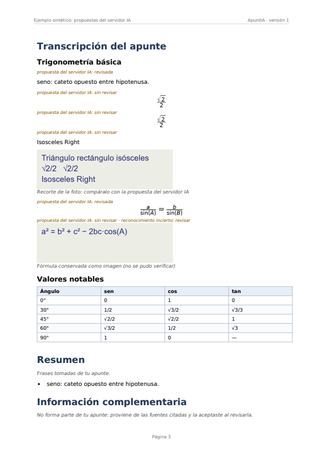

# Generación del PDF educativo (BACK-21/26, ampliada en BACK-38)

Un único exportador: `back/motori_magenes/app/services/pdf.py` (ReportLab), alimentado por
`estructura.py` y ejecutado como trabajo durable `exportacion` (`exportacion.py`). No hay un segundo
generador ni otra base de datos. Contrato HTTP: [api-v2.md §5](api-v2.md).

## 1. Qué contiene

| Parte | Estilo | De dónde sale |
|-------|--------|---------------|
| Portada | ambos | título, fecha, origen (pizarrón/cuaderno), páginas, versión y **avisos** (inciertos, fragmentos sin leer, propuestas de IA sin revisar) |
| Índice | ambos | encabezados reales (TableOfContents) con número de página |
| Transcripción | ambos | bloques en orden, secciones por títulos; fórmulas dibujadas desde LaTeX validado; tablas con encabezado repetido en cada página; esquemas y fragmentos sin leer como imagen con pie |
| Resumen, conceptos, glosario, ejemplos, fórmulas, tabla comparativa | extendido | **solo de bloques confirmados** (ver [trazabilidad-contenido.md](trazabilidad-contenido.md) §4) |
| Información complementaria y Fuentes | si `incluir_complementos` | solo ampliaciones **aceptadas**, con título, autor, licencia, URL y fecha de consulta |
| Anexo de fotos originales | si `incluir_originales` | archivos originales del propio usuario |
| Encabezado y pie | todas menos portada | título, «ApuntIA · versión N», «Página N» |

## 2. Opciones de exportación

| Opción | Por defecto | Efecto |
|--------|-------------|--------|
| `estilo` | `extendido` | `basico`: portada + índice + transcripción + complementos |
| `incluir_originales` | `false` | anexo con las fotos |
| `incluir_complementos` | `true` | sección de investigación aceptada |
| `incluir_recortes_ia` (BACK-38) | `true` | recorte de la foto junto a cada propuesta del servidor IA sin revisar. La **etiqueta** «propuesta del servidor IA: sin revisar» se pone siempre, también con `false` |

La exportación es idempotente por (apunte, versión, opciones): la misma petición reutiliza el PDF. La
clave de opciones por defecto no cambió con BACK-38 (`extendido|o0|c1`), así que los PDFs ya generados
siguen valiendo; `incluir_recortes_ia: false` añade `|r0`.

## 3. Propuestas del servidor IA en el PDF (BACK-38)

- Cada bloque con `procedencia.motor = "ia_remota"` lleva la etiqueta «propuesta del servidor IA: sin
  revisar» o «…: revisada».
- Si está sin revisar y sin corregir, va seguido del **recorte de la foto** («Recorte de la foto:
  compáralo con la propuesta del servidor IA»), para que quien lea el PDF pueda comprobarlo.
- Las partes de una región dividida comparten recorte: se muestra **una sola vez**, al final del grupo.
- La portada cuenta las propuestas sin revisar: «N bloque(s) son propuestas del servidor IA sin revisar…».
- Revisar o corregir el bloque en el editor quita el recorte y el aviso en la siguiente exportación.

## 4. Fidelidad de fórmulas

El PDF dibuja exactamente el LaTeX guardado en la versión (`latex_valido` distinto de `false`), con el
motor de mathtext. Si no se puede dibujar, nunca se inventa otra expresión:

1. con recorte (y no mostrado ya en esa región): «Fórmula conservada como imagen (no se pudo verificar)»;
2. si el recorte ya está en esa región: el LaTeX literal en monoespaciada + «Fórmula que no se pudo
   dibujar: compárala con el recorte de esta región»;
3. sin recorte: el texto literal.

## 5. Seguridad y límites

Todo texto de usuario o de fuentes pasa por `texto_seguro` (sin marcado de ReportLab: `<script>`, `<b>`
o `&` se imprimen literales). LaTeX peligroso o inválido no rompe el PDF (cae a imagen). Imágenes
dañadas o enormes se sustituyen por un aviso. Solo se leen archivos del propietario (un recorte ajeno no
se filtra). Un apunte sin contenido falla con `APUNTE_VACIO` en vez de dar un PDF engañoso. No se
cargan recursos externos: fuentes tipográficas y fórmulas se generan en local.

## 6. Sin conexión

El PDF se genera solo con lo guardado en la versión: funciona aunque el servidor IA o la investigación
no estén disponibles.

## 7. PDFs de referencia y revisión visual (14/11/2026)

| PDF | Origen | Páginas | Revisión |
|-----|--------|---------|----------|
| [`back-38-ejemplo-ia.pdf`](evidencias/back-38-ejemplo-ia.pdf) | sintético (`python -m herramientas.pdf_referencia`) | 4 | etiquetas revisada/sin revisar, región dividida con un recorte, fórmula no dibujable como imagen, tabla, fuentes Wikipedia y Wikilibros |
| [`back-38-ejemplo-largo.pdf`](evidencias/back-38-ejemplo-largo.pdf) | sintético: 12 temas, 12 integrales, tabla de 8 columnas × 59 filas | 30 | índice con páginas correctas, encabezado de tabla repetido, sin solapes |
| `back38-pizarron.pdf` (**privado**, `fullstack/evaluacion/resultados/`, fuera de Git) | foto real del pizarrón → servidor IA real (`qwen3-vl:8b-instruct`, RTX 3060) | 10 | ver abajo |

**Foto real** (sesión del 14/11/2026, extremo a extremo: subir → servidor IA → apunte → PDF con anexo):
17 regiones → 35 bloques (23 salen de dividir regiones multilínea); análisis en 24 s con el modelo ya
cargado (70 s en frío en la primera pasada); 4 fórmulas cuyo LaTeX no se puede dibujar quedan como
imagen o literal; PDF de 10 páginas (antes de no repetir recortes eran 16). Hallazgos que siguen
abiertos: la segmentación todavía une zonas distintas (definiciones + ley de senos + gráfica) y hay
lecturas erróneas del modelo (p. ej. «2bc(\text{sub variable})»); por eso todo va marcado como
propuesta y con su recorte. Entre dos pasadas sobre la misma foto el modelo devolvió 0 y 4 bloques
inciertos: la salida del VLM no es determinista.

## 8. Pruebas

`tests/test_pdf.py` (legibilidad, metadatos, Unicode/HTML, etiquetas, tabla larga, estilos, anexo,
fórmula peligrosa, imagen dañada, vacío, reproducible, muchas páginas, exportar/descargar/reutilizar,
fallo sin PDF, permisos, borrar; **BACK-38**: etiquetas IA, recorte una vez por región, opción
`incluir_recortes_ia`, derivados sin propuestas sin revisar) y `tests/test_analisis_remoto.py` (de la
IA al PDF en proceso). Interfaz: `fullstack/tests/integracion/v2-pdf.test.js`.
