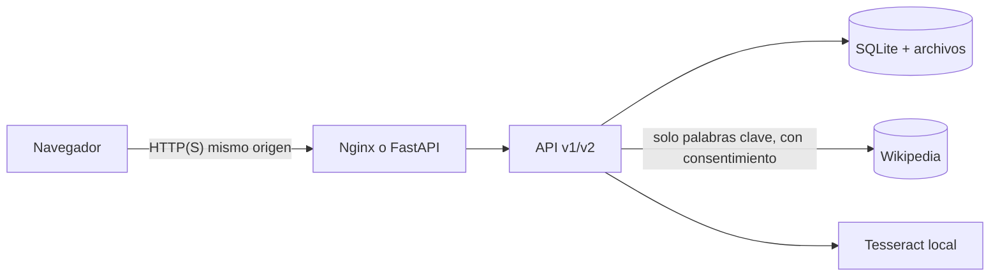

# Auditoría de seguridad y privacidad (FULL-20)

Revisión transversal de ApuntIA (modo con scripts y modo Docker). Para cada amenaza se indica la
mitigación **implementada** y la prueba que la comprueba. No se afirma una seguridad absoluta: al
final están los riesgos que siguen abiertos. Detalle de la API en [`seguridad-api.md`](seguridad-api.md)
y de los datos personales en [`privacidad.md`](privacidad.md).

## 1. Activos y flujos

| Activo | Dónde | Sensibilidad |
|--------|-------|--------------|
| Contraseñas | Solo su hash scrypt en SQLite | Alta |
| Sesiones y CSRF | Cookie HttpOnly (token) + SHA-256 en SQLite; CSRF en memoria de la página | Alta |
| Fotos, recortes, PDF | `DATA_DIR/archivos/<usuario>/` | Alta (pueden tener nombres, notas privadas) |
| Texto de los apuntes, versiones | SQLite | Alta |
| Enlaces de recuperación | `DATA_DIR/buzon/` (desarrollo), hash en SQLite | Alta, 30 min |
| Copias de seguridad | `respaldos/` (0600) | Alta |
| Conceptos investigados | Se envían a Wikipedia solo con consentimiento | Media |
| Registros | `fullstack/.estado/backend.log` / `docker logs` | Media (enmascarados) |

**Superficies de ataque:** subida de imágenes (v1 sin cuenta y v2), formularios de cuenta, API v2
con sesión, descargas de archivos y PDF, contenido externo (Wikipedia), LaTeX del usuario, el proxy
Nginx y los scripts de arranque/copia.

## 2. Amenazas, mitigaciones y evidencias

| Amenaza | Mitigación implementada | Evidencia |
|---------|-------------------------|-----------|
| Acceso a datos de otra cuenta (IDOR, autorización horizontal) | Filtro `usuario_id` en cada consulta; 404 para lo ajeno; no hay roles (sin escalada vertical) | `test_seguridad_api.py` (cada ruta con id, y falla si se añade una sin cubrir), `v2-permisos.test.js` |
| Robo de sesión | Cookie HttpOnly + SameSite=Lax; `Secure` + HSTS con HTTPS; token solo como hash; cierre real en el servidor | `test_cuentas.py`, `v2-cuenta`, `v2-permisos` |
| CSRF | `X-CSRF-Token` + comprobación de `Origin` en todo lo que modifica | `test_seguridad_api.py::test_csrf_y_origen` |
| CORS abusivo | Sin `allow_credentials`; la interfaz va en el mismo origen | `test_cors_no_permite_credenciales…` |
| Fuerza bruta y abuso | 5 fallos/email y 20/IP en 15 min; límites de registro, recuperación, subidas y fórmulas; 3 trabajos por usuario | `test_cuentas.py`, `test_seguridad_api.py` |
| **Falsear la IP tras el proxy** para saltarse los límites | Nginx **sobrescribe** `X-Forwarded-For` con la IP real (antes la añadía a lo que enviaba el cliente: corregido en esta auditoría) | `fullstack/docker/nginx.conf` |
| Enumeración de cuentas | Mismo error para email o contraseña incorrectos; recuperación siempre 202 | `test_cuentas.py` |
| Archivos maliciosos | Firma real del archivo (no la extensión); HTML/PDF/ejecutables disfrazados se rechazan; solo se aceptan imágenes (no hay ZIP ni PDF de entrada) | `test_seguridad_api.py::test_contenido_disfrazado…` |
| **Bomba de descompresión** | Dimensiones leídas de la cabecera antes de decodificar; 400 MP en 380 KB se rechazan en 9 ms sin reservar memoria con `IMAGEN_DEMASIADO_GRANDE` (antes salía como «corrupta»: corregido) | `test_seguridad_api.py::test_bomba_de_descompresion…` |
| Agotar CPU/RAM/disco | Tamaño por foto, megapíxeles, páginas, cuerpo JSON; lado máximo de procesamiento; Tesseract con tiempo límite; trabajos simultáneos; cuota por usuario; Docker con `mem_limit`/`cpus`; `listo` y alertas de disco | `test_seguridad_api.py`, `test_regresion.py`, `test_diagnostico.py` |
| Path traversal | Ids aleatorios en disco; rutas confinadas a `DATA_DIR/archivos/<usuario>`; nombres de archivo solo como dato; copias sin `../` | `test_traversal…`, `test_respaldo.py` |
| Archivos privados por el servidor estático | Solo se sirve `front/` (sin `tests/`, maqueta ni README) y `/inicio`; `DATA_DIR` nunca es estático | `v2-navegacion`, `docker.test.js` |
| XSS | `textContent`/`value` en toda la interfaz; CSP sin scripts ni estilos en línea; CSP `sandbox` en la API; el PDF escapa el texto | `catalogo.test.js` (sin `innerHTML`), `v2-errores`, `test_pdf.py` |
| LaTeX/macros | Lista blanca de comandos y longitud; mathtext sin motor TeX | `test_latex_peligroso…`, `v2-contenido` |
| SSRF | El servidor solo consulta hosts fijos de Wikipedia; nunca URL del usuario | `test_investigacion.py` |
| Prompt injection / contenido externo | No hay ningún modelo de lenguaje: lo externo es texto citado; las páginas con instrucciones incrustadas se descartan | `test_investigacion.py`, `v2-investigacion` |
| Fuga en errores y registros | 5xx genérico + referencia; emails, tokens y contraseñas enmascarados; consultas fuera del log | `test_diagnostico.py`, `test_logs_sin_contrasenas…` |
| Secretos en el repositorio | `buscar_secretos.py` revisa árbol e historial en cada validación; `.env`, bases de datos y copias en `.gitignore` | `validar.sh` (CI) |
| Dependencias vulnerables | Versiones fijadas (`constraints.txt`), `pip-audit` en CI, Dependabot | CI |
| Contenedores | Usuarios sin privilegios, solo lectura, `cap_drop: ALL`, `no-new-privileges`, contexto mínimo sin `.env` ni datos | `docker.test.js` |
| Restauración maliciosa | Copias verificadas (SHA-256, integridad, sin enlaces ni `../`) antes de tocar nada | `test_respaldo.py` |

## 3. Revisión manual de la configuración

- **Modo local:** escucha en `127.0.0.1`; con `--red` se abre a la red local por HTTP sin cifrar
  (útil para el móvil en casa; **no** en una red pública). `fullstack/config/.env` no se sube.
- **Docker:** solo se publica Nginx; el backend queda en la red interna. Sin HTTPS de serie: para
  publicarlo, un proxy con TLS delante y `COOKIE_SEGURA=1`, `URL_PUBLICA=https://…`.
- **CI:** sin secretos (`permissions: contents: read`), datos sintéticos.
- **Revisiones hechas en esta auditoría:** historial de Git sin secretos (231 rutas), `pip-audit` sin
  vulnerabilidades conocidas (noviembre de 2026), bomba de descompresión, cabecera `X-Forwarded-For`.

### Revisión de ApuntIA 3.0 (FULL-32, 14/11/2026)

Hecha en la PC del servidor IA (Windows 11) sobre la rama `feature/FULL-32-cierre`; resultados, no
estimaciones:

| Control | Resultado | Evidencia |
|---------|-----------|-----------|
| Secretos en el árbol y en todo el historial | ninguno (513 rutas) | `buscar_secretos.py` |
| Dependencias Python con vulnerabilidades conocidas | 0 (backend, dev y servidor IA) | `pip-audit -r … -r ia_servidor/requirements.txt` (ahora también en CI) |
| Dependencias npm | 0 | `npm audit` |
| Puertos de la PC del servidor | solo `127.0.0.1:8100` y `127.0.0.1:11434`; ninguna regla de firewall nueva | `Get-NetTCPConnection`, `Get-NetFirewallRule` |
| IDOR, CSRF/CORS, subidas, XSS, límites de tamaño | en verde | `tests/test_seguridad_api.py` (cubre todas las rutas con recurso, incluidas las de IA) |
| SSRF de la investigación | solo hosts fijos de Wikimedia por https; **redirecciones a otro host rechazadas** (nuevo) | `tests/test_investigacion.py` |
| SSRF/fuga del token del servidor IA | el token solo se envía al origen vinculado, sin redirecciones | `tests/test_ia_remota.py` (FULL-31) |
| Tokens por cliente, revocables, guardados como hash | sí | [seguridad-servidor-ia.md](seguridad-servidor-ia.md) |
| Registros sin contenido de apuntes ni cabeceras de autorización | sí (métricas sin conceptos ni texto) | revisión de `investigacion.py`, `ia_remota.py`, `ia_servidor` |
| Licencia del modelo | Apache 2.0, leída del modelo instalado | `ollama show qwen3-vl:8b-instruct --license` |
| Copias de seguridad en Windows | **fallaban** (conexiones SQLite abiertas y rutas con `\`): corregido; en Windows la copia la protege la ACL del perfil (no hay permisos 0600) | `tests/test_respaldo.py` en Windows |

No revisado aquí: la configuración real del túnel (Cloudflare Access / ACL de Tailscale) del dueño
del proyecto, que se hará en la prueba entre dos redes ([pruebas-y-metricas.md §3](pruebas-y-metricas.md)).

## 4. Riesgos abiertos (no resueltos)

| Riesgo | Por qué sigue | Qué hacer |
|--------|---------------|-----------|
| Sin TLS de serie | Es una aplicación local/académica | Proxy con TLS para cualquier uso fuera del equipo |
| Datos sin cifrar en reposo (SQLite, archivos, copias) | El equipo es de quien la instala | Cifrado de disco; `gpg -c` para copias que salgan del equipo |
| Recuperación sin servidor de correo | El enlace va al buzón de desarrollo | Integrar SMTP antes de un uso real |
| Sin segundo factor | Fuera del alcance | — |
| Registro revela que un email existe | Inherente a crear cuentas con email | Mensaje que no confirma de quién es; límite por IP |
| Límites por IP detrás de un NAT (aula) | Toda la clase comparte IP | Subir `MAX_REGISTROS_HORA` en ese caso |
| Interfaz probada solo en Chromium | Entorno de pruebas | Probar en Firefox/Safari antes de la entrega |
| Conexión entre dos redes sin probar con la laptop | El túnel se probó por Internet desde la propia PC; falta la laptop en otra red | Pasos en [conexion-remota.md §6](conexion-remota.md); `validar.ps1 -SoloRemoto -Remoto https://…` antes de la exposición |
| El servidor IA ve la foto completa | La necesita para leerla | Solo se envía al servidor propio vinculado; ApuntIA no la manda a servicios de IA de terceros |
| Con Cloudflare Tunnel, Cloudflare descifra el HTTPS en su red | Así funciona el túnel: termina TLS en Cloudflare y lo reenvía a la PC | Para fotos de alumnos, Tailscale (cifrado de equipo a equipo); el Quick Tunnel solo para pruebas con imágenes sintéticas |

## 5. Lista de comprobación de seguridad para cada versión

- [ ] `fullstack/scripts/validar.sh --completo` en verde (incluye IDOR, CSRF/CORS, subidas, XSS, secretos)
- [ ] `pip-audit` sin vulnerabilidades (CI) y Dependabot revisado
- [ ] `python fullstack/scripts/buscar_secretos.py` sin hallazgos
- [ ] Ningún `.env`, base de datos, copia ni foto real en el repositorio ni en las imágenes
- [ ] Cabeceras de seguridad y CSP iguales en modo local y Docker (`v2-navegacion`, `docker.test.js`)
- [ ] `COOKIE_SEGURA=1` y `URL_PUBLICA` si se publica por HTTPS
- [ ] Copia de seguridad hecha antes de actualizar
- [ ] Riesgos abiertos revisados y comunicados
